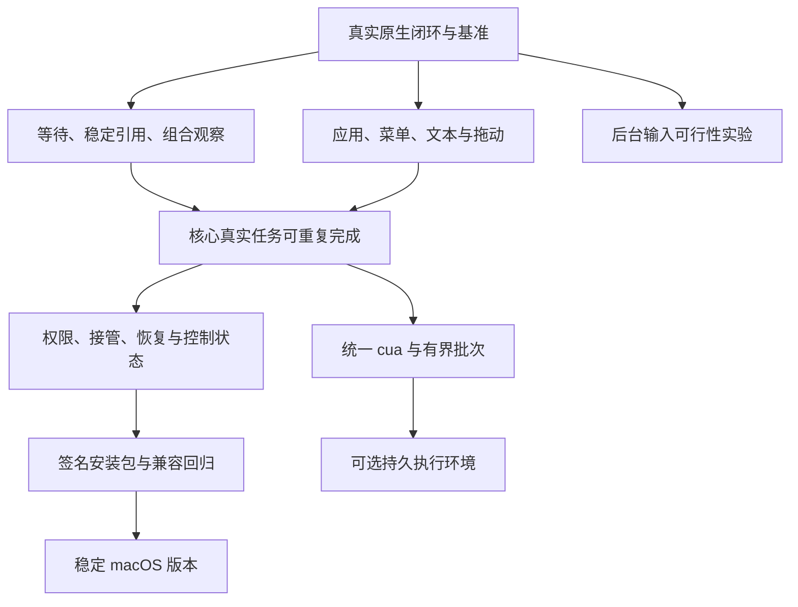

# Hanekawa macOS Computer Use 后续实施计划

状态：已开始推进；CU-001 / CU-003 已完成，CU-002 / CU-101～CU-106 / CU-203 / CU-302 / CU-303 / CU-304 有局部进展，M0 尚未完成。创建于 2026-11-04（Asia/Shanghai）。最新证据见 [自有 AppKit 原生闭环与故障修复](CU-NATIVE-CLOSURE-2026-11-04.md)。此前证据见 [基线与差分修复记录](CU-BASELINE-2026-11-04.md)、[CU-003 原生验证记录](CU-003_VALIDATION_2026-11-04.md)、[CU-101 等待验证记录](CU-101_VALIDATION_2026-11-04.md)、[CU-102 身份与差分验证记录](CU-102_VALIDATION_2026-11-04.md) 及 [主动授权与中断恢复验证记录](CU-002_303_VALIDATION_2026-11-04.md)。

本次续进：真实计算器、文本编辑、访达基准已建立，访达独立重命名编辑器及失败清理已修复；协议现为 `hanekawa-computer/4`。偶发启动阶段目标变化仍保留为未解决基线，CU-004 / M0 不整体完成。见 [本批真实应用与清理验收](CU-REAL-APPS-2026-11-04.md)。

工作分支：`codex/rebuild-computer-use`。

本文以 agent 连续实施为工作方式，使用任务、依赖、验收条件和证据组织工作，不采用人日、人工排期或将人工工作量换算为 agent 执行时间。完成一个任务的依据是验收通过；遇到外部依赖时，记录具体阻塞点并推进不受影响的任务。

本文与全部参考资料统一保存在 `computer-use-reference/`，随当前分支提交到 Git，供跨机开发同步；面向用户的已实现行为继续维护在 `README.md`。计划中的拟议行为不能提前写成 README 中的现有能力。

## 1. 目标与范围

### 1.1 本轮目标

将现有“结构化 Computer 工具 + Swift 原生 helper”推进为 macOS 上可连续完成真实任务、行为可解释、能正确取消并经过安装包验证的功能。

本轮优先级依次为：

1. 证明现有原生链路在真实应用上可用，建立可重复的失败样例。
2. 修复观察、引用、输入和用户接管的可靠性问题。
3. 补齐真实任务需要的应用、菜单、弹窗、文本和拖动操作。
4. 补齐权限、控制状态、暂停/释放及错误恢复的用户体验。
5. 完成开发构建与安装包的权限、资源和生命周期验证。
6. 再推进统一 `cua` 对象接口、受限批次和持久执行环境。
7. 对后台输入单独做可行性验证，以实测决定支持范围。

### 1.2 支持范围

- 主验证环境：当前 Apple Silicon macOS 环境，记录具体系统版本。
- 首轮完整截图流程：macOS 14.4+；现有 macOS 13+ AX 路径继续保持兼容，不在未经验证时宣称所有版本均已通过。
- 第一组真实应用：计算器、文本编辑、访达。
- 第二组真实应用：至少一个 Electron 应用，优先使用隔离测试窗口或自有测试应用；飞书等实际应用只在明确的测试区域操作，不发送真实消息。
- Browser 继续使用已有后端，先保持现有功能和权限行为，再扩展统一入口。
- 所有写入型 GUI 验收使用专用临时目录、无敏感内容的测试文档和明确的目标窗口。

### 1.3 本轮不预先承诺

- Codex macOS 功能逐项完全等价。
- 任意应用都能在后台完成键盘、鼠标、输入法和拖动操作。
- Windows/Linux 原生桌面后端。
- 锁屏操作、自动解锁、系统授权数据库修改。
- 给模型开放任意 Node.js、shell、文件系统、网络或完整 CDP。
- 复用 Codex 的专有二进制、私有服务、宿主令牌或安装包提取代码作为产品依赖。

## 2. 当前基线：已接入与未验证要分开

### 2.1 代码已经具备的能力

| 能力 | 当前实现 | 验证边界 |
| --- | --- | --- |
| 工具接入 | 桌面通过 `extraTools` 注册 `Computer` | 已通过构建，不等于当前运行中的旧实例已经加载 |
| 应用绑定 | 会话持有 `appId`，helper 固定应用进程及启动身份 | 只绑定已经运行的应用，不负责启动 |
| 窗口选择 | 返回窗口句柄，支持选择并沿用窗口 | 复杂窗口、菜单和特殊浮层待真实验证 |
| AX 观察 | 深度、节点数、时间预算和子树读取 | 当前主要从选中窗口开始遍历 |
| 差分 | 按保守内部身份比较，当前短索引与身份分离，显式 revision/baseRevision/mode | 协议模拟和身份规则自检通过，真实 AX 对象及虚拟化列表兼容性待验 |
| 语义动作 | AXPress、设置 AXValue、调用已暴露 AX action | 真实应用兼容性尚未完成验收 |
| 物理输入 | 点击、按键、Unicode 文本、滚动 | 激活并抬起窗口；不是完整后台输入 |
| 截图 | ScreenCaptureKit，匹配进程与窗口几何信息，返回点/像素元数据 | 无法唯一匹配时拒绝；特殊窗口和多显示器待验证 |
| 生命周期 | 全局队列、截止时间、取消回收、进程租约、会话/窗口退出清理 | 已有模拟 helper 回归；真实 AX 阻塞与系统事件待测 |
| 图片接入 | 图片进入现有附件存储，不把 base64 写入文本结果 | 缩放后的坐标映射仍要真实点击核对 |
| 构建分发 | 自有 Swift helper 编译，并配置为 ASAR 外资源 | 签名安装包、升级和 TCC 归属未完成验收 |

### 2.2 已有验证记录

以下为本会话此前执行所得的基线记录，不表示本计划中的任务已经完成：

- 类型检查通过；桌面构建通过；Swift helper 编译及无 GUI 自检通过。
- 最终定向回归：181 项通过。包含 Computer、权限及 ShellHost 测试，不能解释为 181 项真实 macOS GUI 测试。
- 此前全量回归：4,760 项通过、2 项跳过、2 项失败。全量回归之后又增加了少量定向测试，后续应重新记录实际总数。
- 失败之一为遮罩样式断言，已在未修改的 HEAD 快照复现。
- 失败之二为调度唤醒测试在全量运行时超时，单独复验通过；仍须在测试报告中保留该差异。
- 原生 helper 在正常桌面权限下成功列出应用；当时辅助功能权限未授予，因此真实 AX 点击、输入尚未验收。权限状态会变化，实施前必须重新检查。

### 2.3 首先处理的实现风险

1. 动作后固定 120ms 等待已替换为宿主有界稳定观察，并增加显式 `wait_for`；目前有协议模拟证据，慢加载、动画和异步保存仍待真实 AX 验收。
2. AX 短索引仍按本次遍历编号；已新增独立内部身份与移动来源，但内容变化会保守地重新分配身份，真实虚拟化列表兼容性和差分效率仍待验收。
3. 每次动作后自动重新观察有助于正确性，但成本、输出长度和额外原生请求尚无真实基准。
4. 完整窗口树可能缺少菜单栏、弹出菜单和独立浮层，需要按真实样例补观察范围。
5. 物理事件依赖前台窗口；前台检查和事件投递之间仍存在用户切换的竞态窗口。
6. 截图主要按 PID 和几何信息匹配，重叠窗口、相同尺寸及特殊窗口可能被拒绝。
7. 权限设置链接只在工具结果中返回，缺少产品内持续可见的状态和恢复入口。
8. 当前打包配置使用 ad-hoc 身份且未启用公证；不能把本地能编译当作可分发验收。

## 3. 任务看板与依赖

任务初始状态统一为 `[ ]`。实施时可更新为“进行中 / 已完成 / 被阻塞 / 暂缓”，同时记录证据链接和未完成项。不得仅因代码已写入而勾选完成。

| 里程碑 | 任务 | 依赖 | 放行条件 |
| --- | --- | --- | --- |
| M0：原生链路可信 | CU-001～CU-004 | 当前重构代码 | 自有测试应用 + 第一组真实应用完成观察/动作/验证/取消 |
| M1：可日常试用 | CU-101～CU-106、CU-201～CU-204、CU-301 的必要部分 | M0；独立模型/协议工作可先开展 | 核心任务可重复完成，等待/引用/输入问题有回归覆盖 |
| M2：稳定 macOS 版本 | CU-205～CU-206、CU-301～CU-304、CU-401～CU-404 | M1 | 第二组应用、接管、生命周期和安装包验收通过 |
| M3：对齐统一调用方式 | CU-501～CU-504 | M1；M2 的权限/生命周期契约稳定 | 统一对象 API 与有界批次可用；执行边界经独立验证 |
| 独立研究：后台输入 | CU-601～CU-603 | M0；需要正常桌面环境 | 有能力矩阵和可复现证据，再决定是否实施 |



## 4. M0：打通真实 macOS 验收

### CU-001：重新固定基线与环境

- [x] 记录 Git 基点、当前分支、未提交变更、Node/Electron/Swift/macOS 版本和架构。
- [x] 保留当前重构内容，确认没有用户新增的无关变更需要避让。
- [x] 记录 `Computer` 当前 operation、输入限制、风险分级及原生协议版本。
- [x] 确认开发态与打包态 helper 路径、可执行权限及旧资源清理行为（打包态路径按配置核对，安装包实测仍属 CU-402）。
- [x] 复核已有失败测试，区分已知基线、环境限制与新增回归。

完成证据：一份带环境和命令结果的基线记录。后续测试引用该记录，避免混淆不同构建。

2026-11-04：已完成，详见 [CU-001 证据](CU-BASELINE-2026-11-04.md)。

### CU-002：验证权限归属与正常授权流程

- [ ] 在实际 Hanekawa/Electron 执行链中调用 `status`，不能只看终端启动 helper 的结果。
- [ ] 分别验证辅助功能缺失、屏幕录制缺失、权限已授予三种情况。
- [ ] 明确应由用户给哪个应用授权；权限缺失时给出可操作的说明和系统设置入口。
- [ ] 验证授权后是否需要重开 helper 或重启主应用，并据实记录。
- [ ] 验证不会因普通观察反复弹系统授权窗口。

外部依赖：macOS 授权只能由用户正常完成。未授权时可继续做协议、模拟驱动和测试应用准备，不绕过 TCC，不伪造真实 GUI 通过记录。

2026-11-04 局部进展：新增 `npm run verify:computer:electron`，隔离 Electron → 正式宿主 → helper 的只读 status 链路通过；实测辅助功能 false、屏幕录制 true。尚非完整 Hanekawa / 安装包三态验收，不勾选上述项目。证据见基线记录 §4。

2026-11-04 本批续进：应用户明确要求增加 `--request-accessibility` 主动授权入口，调用系统提示、打开设置并定位实际开发 Electron.app，保留进程供用户确认；默认 status 不申请权限。新进程及最终原生 fixture 仍为 Accessibility=false，正常授权和恢复尚未验收，CU-002 保持部分完成。见 [本批证据](CU-002_303_VALIDATION_2026-11-04.md)。

2026-11-04 本批续进：用户已正常授权本次执行链的实际宿主，正式 helper 的 Accessibility / Screen Recording 均为 true。系统 TCC 日志确认本次由 Codex 启动的链路归属 `/Applications/ChatGPT.app`；仅开启 Electron 不足以使这条链路通过。安装包与完整产品三态验收仍未完成。 详见 [原生闭环与故障修复记录](CU-NATIVE-CLOSURE-2026-11-04.md)。


### CU-003：建立自有 GUI 测试应用

- [x] 提供可重复启动/关闭的 AppKit 测试应用，测试数据只进入隔离临时目录。
- [x] 包含按钮、计数值、普通输入框、安全输入框、滚动列表、延迟更新、弹窗和两个窗口。
- [x] 支持制造列表插入/重排、控件替换、窗口移动、窗口关闭和应用重启。
- [x] 测试 harness 只负责准备环境和独立核对结果，实际 UI 动作必须经过生产 Computer 路径（本批真实动作分支已通过）。
- [x] 将“协议模拟”“真实原生”“真实模型任务”三类测试明确标注，不互相替代。

完成证据：可重跑脚本、运行环境、helper 版本及断言结果。GUI 不可用或权限不足时显式记录 skipped/blocked，不能静默通过。

2026-11-04 局部进展：自有双窗口 AppKit fixture 与 `npm run test:computer:native` 已建立；编译、启动、初始状态、生产发现、重启和回收有实测。默认入口在缺辅助功能时验证生产绑定拒绝，以 77 / blocked 退出。按钮、文本、列表、延迟、sheet 等控件及动作断言已编写，实际交互仍待授权，故本任务和 M0 均不标为完成。见 [CU-003 证据](CU-003_VALIDATION_2026-11-04.md)。

2026-11-04 本批续进：已完成自有 AppKit 测试应用和生产驱动的首次完整原生闭环（20 项阶段检查）。点击、文本、选区、列表、菜单/sheet、组合截图与坐标点击、取消、应用重启及清理均有独立状态核对。初始完整差分断言因输出预算截断仍为 unverified；这不等于 CU-004 或 M0 完成。 详见 [原生闭环与故障修复记录](CU-NATIVE-CLOSURE-2026-11-04.md)。


### CU-004：第一组真实任务基准

- [ ] 计算器：完成一个确定的算式，AX 与截图共同核对结果。
- [ ] 文本编辑：输入含中文、英文、emoji、换行的内容，保存到测试目录，再重新打开核对。
- [ ] 访达：在测试目录创建、重命名和选择文件夹，核对名称和位置。
- [ ] 两个同名或相似标题窗口：选择指定窗口，确认另一窗口没有被修改。
- [ ] 动作等待期间取消：确认不再继续派发后续动作，helper 被回收。
- [ ] 目标应用重启：旧绑定拒绝动作，新绑定从新观察开始。

每个场景至少重复 3 次并保留成功和失败记录。M0 要求证明基本原生链路、取消和重启行为；复杂场景暴露的缺陷以任务/回归样例进入 M1，不要求先在 M0 实现后续全部能力。真实应用操作只使用新建测试资料；涉及消息发送、真实账号或已有文件时，不将其作为默认测试目标。

2026-11-04 本次续进：计算器、文本编辑、访达均有三轮真实成功记录；另保留启动/首次输入前偶发 `TARGET_CHANGED`、重命名编辑框自动伸缩和关闭期间 AX 属性变化的失败记录。访达错误 -8072 已由用户配合复现，根因为测试在活跃重命名期间删除临时目录；现先关闭窗口再删资料，无法确认关闭时保留目录。尚未查清偶发启动目标变化，因此 CU-004 和 M0 保持部分完成。详见 [本批证据](CU-REAL-APPS-2026-11-04.md)。

## 5. M1：观察、引用与输入可靠性

### CU-101：替换固定等待，增加有界稳定观察

涉及：Swift helper、`host.ts`、原生协议、工具 schema/prompt、对应测试。

- [x] 将“动作投递成功”“界面已稳定”“业务条件满足”作为不同结果（协议模拟验证，真实 AX 待验收）。
- [x] 设计统一截止时间，动作后的观察只能消费剩余预算，不能每个内部步骤重新获得完整 timeout。
- [ ] 优先评估 AX 通知；针对不发通知或通知不足的应用，提供有界轮询。
- [x] 增加 `wait_for` 能力，覆盖元素出现/消失、文本或值片段满足、窗口出现/关闭；最终接口已经用户确认。
- [x] 返回 `settled / matched / timed_out / unsupported` 等明确状态及最后可用观察，不把局部等待超时当成动作未送达；总截止时间仍按原有错误与回收契约处理。
- [x] 取消能中断等待；失败后不自动重发有副作用输入（协议模拟验证，真实取消待验收）。

验收：测试应用中随机延迟更新、持续变化、弹窗异步出现和永久不满足条件均有确定结果；无需模型手写 sleep 才能得到正确状态。

2026-11-04 局部进展：按用户批准的 [CU-101 实施方案](CU-101_IMPLEMENTATION_PLAN.md) 实现可取消轮询、动作后稳定观察和只读 `wait_for`。内部样本不污染面向模型的差分基线。AX 通知没有进行真实兼容性比较，当前未新增订阅协议。测试应用新增异步 sheet，driver 增加延迟条件、永久不满足和弹窗分支；辅助功能仍为 false，真实分支不得标为通过，CU-101 整体及 M0 仍未完成。详见 [本批证据](CU-101_VALIDATION_2026-11-04.md)。

2026-11-04 本批续进：真实延迟条件 matched、永久不满足 timed_out、异步 sheet 已在 AppKit fixture 通过。另将 AX 动作通信超时与读取的 250ms 超时分离：动作使用 1 秒，仍受总 deadline 约束，不增加固定等待或自动重试。通知比较和更广的等待场景仍未完成。 详见 [原生闭环与故障修复记录](CU-NATIVE-CLOSURE-2026-11-04.md)。


### CU-102：建立稳定的内部元素身份与显式差分基线

- [x] 分离“内部元素身份”“当前观察短索引”“快照版本”，避免把遍历序号当永久身份（实现及协议/规则回归通过，真实 AX 待验）。
- [x] 明确 CFEqual、identifier/内容指纹、所属窗口与父级身份的组合规则，不按标题匹配不同 AX 对象；真实应用兼容性待评估。
- [x] 为控件复用定义保守失效规则：内容、对象或父级变化即分配新身份，动作前仍核对完整私有指纹；虚拟化列表实测待授权。
- [x] 差分显式携带 `revision / baseRevision / mode`；基线丢失、窗口变化、新绑定或截图后的 AX 读取返回 full。
- [x] 保留每次动作消耗快照的保守语义，没有放宽批次或旧引用使用。
- [x] 针对插入、删除、重排、同名元素、控件替换和子树读取建立回归；协议测试证明差分可还原。

验收：列表变化不会把旧 ref 指向不同业务对象；差分可以从指定基线恢复为正确完整状态；完整刷新后旧引用仍被拒绝。

2026-11-04 局部进展：修复原生截断误报节点删除，以及截断/子树结果污染下一次窗口差分基线；补充三项宿主回归。内部稳定身份及显式 revision/baseRevision 尚未实现，本任务不勾选完成。证据见基线记录 §5。

2026-11-04 后续进展：按用户批准的 [CU-102 实施方案](CU-102_IMPLEMENTATION_PLAN.md) 实现保守内部身份、显式差分基线及可还原的移动/删除来源，升级原生协议为 `hanekawa-computer/2`。另修复窗口条件依赖无关 AX 树读取的问题，补齐版本递增与截图窗口身份校验。代码子项已验证；真实 AX 对象、控件复用及虚拟化列表验收仍 blocked，CU-102 整体和 M0 均未完成。见 [本批验证记录](CU-102_VALIDATION_2026-11-04.md)。

### CU-103：扩大观察范围，覆盖菜单和特殊界面

- [ ] 增加应用级、窗口级、菜单/弹窗级观察范围，保留所属应用与窗口身份。
- [ ] 验证菜单栏、上下文菜单、sheet、保存/打开对话框和独立浮层的实际 AX 归属。
- [ ] 为系统托管的选择器明确权限和身份边界，不把别的进程错误视为原目标窗口。
- [ ] 输出暴露实际可用 action 和可写属性；不在提示词中虚构所有应用都支持的动作。
- [ ] 延续安全输入字段脱敏，并验证其子树不会泄露值。

验收：至少覆盖“菜单打开 → 选择菜单项 → 对话框出现 → 输入 → 确认”的完整链路，并能在窗口变化时取得正确新状态。

2026-11-04 后续进展：新增应用/窗口 scope、应用菜单栏和聚焦弹出界面入口、节点可写属性与所属窗口信息，严格排除外进程节点并阻止安全字段子树读取；应用 scope 不能授权物理输入。自有 fixture 新增菜单 → 输入 sheet → 明确确认链路，协议回归及构建通过；实际 AX 菜单、sheet 和系统托管选择器仍因 Accessibility=false 未验收，不勾选整个任务。见 [本批证据](CU-103_104_106_203_VALIDATION_2026-11-04.md)。

2026-11-04 本批续进：首次真实菜单 → sheet → 输入 → 明确确认链路通过；安全字段未泄露。复现并修复长列表先耗尽文本预算、隐藏后续浅层按钮的问题，保留分支入口和原索引，纯模型回归及真实控件替换场景通过。系统托管选择器、上下文菜单和独立浮层仍待验收。 详见 [原生闭环与故障修复记录](CU-NATIVE-CLOSURE-2026-11-04.md)。


2026-11-04 本次续进：访达把重命名框作为无 AXWindow / AXFocusedWindow 的独立 AXTextField 顶层对象暴露。窗口列表增加必需的实际 role（不可读时为空），仅对已处于前台实际焦点的该编辑器允许键盘输入；不自动抬起、不允许指针输入。输入导致的伸缩保留同一对象身份，动作后关闭竞态只补读窗口列表确认，不重发动作。未知角色继续拒绝物理输入。新旧版本严格隔离，协议升级为 v4。见 [本批证据](CU-REAL-APPS-2026-11-04.md)。

### CU-104：统一 AX 与截图的观察身份和坐标契约

- [ ] 设计可选组合观察：AX、截图、二者组合，保留来源窗口、进程、时间和各自 revision。
- [ ] 明确组合观察不是系统级原子快照；检测到采样期间窗口变化时拒绝或重新观察。
- [ ] 核对标题栏、窗口阴影、Retina 缩放、附件降采样、多显示器和负屏幕坐标。
- [ ] 评估更可靠的窗口匹配方案；无法唯一匹配时继续拒绝，不退回“第一个窗口”。
- [ ] 验证窗口移动/缩放后旧坐标快照拒绝动作。
- [ ] 按任务需要返回图片，避免每次 AX 读取都额外消耗图片和附件成本。

验收：在不同缩放和窗口位置下，从附件像素换算后的点击命中测试控件；AX、图片和动作均可追溯到正确目标。

2026-11-04 后续进展：`get_state includeScreenshot:true` 提供可选 AX+截图，明确非原子采样、双 revision/时间来源以及统一可用 ref；采样间窗口、PID、几何信息或版本不符即拒绝，修复异步异常逃过绑定回收的问题。协议回归通过，原生 driver 已加入点/像素点击核对但尚未实际执行；Retina/降采样/多显示器/特殊窗口匹配仍未验收。见 [本批证据](CU-103_104_106_203_VALIDATION_2026-11-04.md)。

2026-11-04 本批续进：复现 ScreenCaptureKit 过滤器在 helper 未初始化 AppKit 时触发 CGS_REQUIRE_INIT 崩溃；不实际截图的独立对照确认 NSApplication.shared 修复，生产 helper 已初始化且禁止激活。真实 AX+PNG 来源与像素到点换算点击通过；附件降采样、多显示器、移动窗口等仍未验证。 详见 [原生闭环与故障修复记录](CU-NATIVE-CLOSURE-2026-11-04.md)。


### CU-105：提高文本与快捷键输入可靠性

- [ ] 验证 Unicode 输入的中文、emoji、组合字符、换行和长文本行为。
- [ ] 区分替换字段值、追加输入、聚焦、选择文本和粘贴，不让一个接口隐式承担不同语义。
- [ ] 核对快捷键布局、大小写、组合键及不支持键的错误说明。
- [ ] 新增纯文本粘贴时记录剪贴板 changeCount，仅在仍由本次操作占有时恢复旧内容，避免覆盖用户后来复制的内容。
- [ ] 富文本、HTML、文件剪贴板按独立能力协商，不随纯文本能力默认开放。
- [ ] 输入失败返回实际投递阶段，不通过未授权的物理路径自动替代 AX。

验收：测试文档最终内容与输入完全一致；焦点失败不把文本送进别的窗口；用户同时修改剪贴板时不会被旧内容覆盖。

2026-11-04 局部进展：复现并修复 Swift 字符截断与 TS UTF-16 长度校验不一致的问题，避免 emoji 密集 AX 内容导致整个观察被拒绝；原生无 GUI 自检覆盖字符边界，真实长 emoji 输入/读回分支已加入 driver、待授权。其余文本、快捷键和剪贴板项目保持未完成。见 [CU-101 同批证据](CU-101_VALIDATION_2026-11-04.md)。

2026-11-04 本批续进：键盘输入增加实际 AX 焦点、PID、所属窗口及安全祖先检查；`ref` 必须与实际焦点一致，连续文本每个事件对前复查。Unicode 编码读回校验、修饰键清空、无悬挂的事件对和中断派发数量通过无 GUI 自检；未声称真实 AppKit 输入已通过。新增拒绝 AX 聚焦的 fixture、实际 Unicode 输入/替换/快捷键分支，待正常授权后验收；未增加剪贴板能力。见 [CU-105 / CU-302 本批证据](CU-105_302_VALIDATION_2026-11-04.md)。

2026-11-04 本批续进：自有 AppKit 的真实混合 Unicode 输入、局部替换、cmd+a、拒绝聚焦和长 emoji AXValue 读回通过。测试应用补齐标准 Select All 菜单；未增加粘贴或剪贴板能力，不能扩展为所有输入法/Electron 均已验收。 详见 [原生闭环与故障修复记录](CU-NATIVE-CLOSURE-2026-11-04.md)。


### CU-106：增加分阶段诊断与模型调用成本记录

- [ ] 记录排队、helper 启动、AX 读取、动作、稳定等待、截图、附件导入的阶段耗时。
- [ ] 记录 request/session/binding/snapshot 标识、动作类型、错误 code、delivery 和最终验证状态。
- [ ] 普通诊断默认不额外保存 AX 全文、输入正文、截图或配置密钥；会话现有工具记录行为按项目规则处理。
- [ ] 为一次任务统计工具调用次数、观察次数、完整树/差分字符量、图片数和模型重试次数。
- [ ] 输出可对照的基线与改进记录；未采集足够样本前不声称性能提升比例。

验收：能够根据失败记录区分排队慢、AX 慢、界面未稳定、输入未送达和模型选错控件。

2026-11-04 后续进展：加入每次工具调用的数值诊断（队列、helper spawn、原生方法、等待、附件导入、调用/观察次数、字符量、图片字节、code/delivery），默认不另存正文或截图。隐私与跨会话隔离回归通过。组合请求内部 AX/截图耗时尚未分别计量，helper spawn 不是 ready，任务级模型重试统计和真实性能对照仍未完成，CU-106 保持部分完成。见 [本批证据](CU-103_104_106_203_VALIDATION_2026-11-04.md)。

## 6. M1/M2：补齐真实任务所需能力

### CU-201：应用发现、启动与绑定

- [ ] 在现有 list/bind 基础上增加明确的启动操作；绑定本身继续保持无启动副作用。
- [ ] 按名称、bundle ID 或规范化应用路径解析目标，歧义时返回候选而非猜测。
- [ ] 不开放任意启动参数、环境变量、工作目录或 shell 命令。
- [ ] 应用授权与风险判断在解析后的真实目标上完成；授权输入固定后再执行。
- [ ] 应用启动后等待可观察窗口；无窗口时返回明确状态。

验收：未运行的指定应用可以正常启动、绑定；同名目标不会绑定错误应用；拒绝/取消不会留下继续执行的后台任务。

### CU-202：菜单、弹窗及窗口管理

- [ ] 复用 CU-103 的观察范围，为菜单和弹窗提供明确操作路径。
- [ ] 区分聚焦、抬起、最小化、关闭窗口、退出应用等不同副作用。
- [ ] 只根据真实任务需要开放操作，并为新能力补风险分类、输入校验和权限模式测试。
- [ ] 危险确认框不由通用“遇到弹窗自动确认”逻辑处理。

验收：文本编辑保存对话框、访达上下文菜单和测试应用 sheet 至少各完成一条可重复任务链路。

2026-11-04 本批续进：自有 AppKit 菜单和 sheet 输入/确认链路已真实通过，危险弹窗没有自动确认逻辑。文本编辑与访达链路仍待 CU-004 验收，未增加关闭/退出等新的产品操作。 详见 [原生闭环与故障修复记录](CU-NATIVE-CLOSURE-2026-11-04.md)。


### CU-203：文本选择与纯文本粘贴

- [ ] 支持按范围/匹配文本选择；重复文本允许使用上下文消歧。
- [ ] 对无法提供选区的控件返回 unsupported，不假定键盘替代一定成功。
- [ ] 纯文本粘贴复用 CU-105 的剪贴板所有权与恢复策略。
- [ ] 在 AppKit 与至少一个 Electron 输入控件中验证多行中文输入。

验收：只替换指定片段、保持其他内容；粘贴完成后结果可读回验证，用户剪贴板不被错误恢复。

2026-11-04 后续进展：实现独立 `focus` 和 `select_text`，支持 UTF-16 选区与相邻 prefix/suffix 消歧；不支持/歧义时不发送键盘替代。原生自检复现并修复系统字符串范围转换允许切开 emoji 代理对的问题。已加入自有控件独立读回分支，真实 AppKit/Electron 选区仍待授权；纯文本粘贴与剪贴板所有权未实施，因此 CU-203 仍不完成。快捷键的 US ANSI 键位和显式 shift 语义同步说明，CU-105 其他未验证项保持原状态。见 [本批证据](CU-103_104_106_203_VALIDATION_2026-11-04.md)。

2026-11-04 本批续进：范围/匹配选区、相邻上下文、歧义拒绝及真实键盘局部替换已在自有 AppKit 独立读回。纯文本粘贴、剪贴板所有权与 Electron 仍未完成。 详见 [原生闭环与故障修复记录](CU-NATIVE-CLOSURE-2026-11-04.md)。


### CU-204：滚动与可见区域定位

- [ ] 区分滚动容器、窗口与页面；明确方向、距离单位和是否实际发生滚动。
- [ ] 优先使用可用 AX 路径，物理滚动遵守前台目标与权限规则。
- [ ] 为滚动到元素、列表懒加载和边界无法继续滚动提供明确结果。
- [ ] 滚动后返回新观察；旧坐标与虚拟化元素身份按契约失效。

验收：长列表能找到指定测试条目；到达边界时停止，不产生无限滚动循环。

### CU-205：拖动与输入释放

- [ ] 输入协议显式描述起点、终点、路径/持续时间及按钮状态。
- [ ] 设计取消、超时、用户接管、helper 崩溃时的释放责任；释放不能依赖正常完成回调。
- [ ] 区分拖动失败、部分投递与已完成；不自动重做文件移动。
- [ ] 首先在自有测试应用验证拖动，再在测试目录验证访达场景。

验收：取消和进程故障后不遗留按下的按钮/修饰键；文件只移动到指定位置；来源和目标窗口变化时停止。

### CU-206：Electron 应用适配与能力说明

- [ ] 选择一个明确目标应用和版本，验证其 AX 树质量、输入、菜单、弹窗和滚动。
- [ ] 不默认对应用注入启动参数、调试端口或强制开启特殊模式。
- [ ] 对缺失 AX、画布控件及无法语义操作区域，明确说明截图/坐标路径和限制。
- [ ] 应用专用操作说明按需提供，记录适用版本，不把一次修复扩散成所有应用的默认规则。

验收：至少完成一条不涉及真实发送或敏感资料的完整 Electron 应用任务，并保留失败样例。

## 7. M2：权限、用户接管和生命周期体验

### CU-301：权限和控制状态界面

- [ ] 复用现有设置、状态卡片、错误展示和 popover 机制，展示 OS 权限状态及当前绑定应用/窗口。
- [ ] 提供明确的暂停/停止/释放入口，并说明释放控制不会退出目标应用。
- [ ] 区分 OS 权限、工具权限模式、单应用访问范围和正在占用的租约。
- [ ] OS 权限检查与用户主动申请分开，不在后台反复触发提示。
- [ ] 若加入应用级持久授权，接入现有配置与授权体系；deny 仍然绝对生效，不绕过原工具权限模式。
- [ ] 外部设置入口通过宿主受控操作打开，renderer 不获得任意 IPC 或系统命令能力。

验收：用户能在应用内判断缺哪项权限、当前谁在控制哪个窗口，并能停止；拒绝操作后界面状态与实际进程一致。

### CU-302：用户接管

- [ ] 区分 agent 自己发出的输入和用户输入，评估可用的事件来源与必要系统权限。
- [ ] 支持显式接管；自动检测只在证据可靠的范围内启用。
- [ ] 接管后停止当前动作后续阶段和排队中的旧输入，失效相关快照并释放按下状态。
- [ ] 返回 `user_takeover` 等可识别原因，恢复需要新观察；不自动抢回焦点。
- [ ] 检查多窗口内切换、切到其他应用、用户移动窗口三类情况。

验收：用户接管后旧任务不会继续点击或输入，也不会循环激活窗口与用户争夺控制。

2026-11-04 本批局部进展：连续 Unicode 输入在检查到控件焦点、应用或窗口变化时停止后续字符，沿用 `TARGET_CHANGED` 回收绑定；宿主回归证明排队的旧绑定输入不再投递，未知投递不重放。没有实现显式接管 UI、全局用户事件检测或后台输入，不能据此将 CU-302 标为完成。见 [本批证据](CU-105_302_VALIDATION_2026-11-04.md)。

### CU-303：崩溃与中断恢复

- [ ] 覆盖 helper 启动失败、非法响应、输出关闭、崩溃、AX 卡住、应用退出和应用重启。
- [ ] 延续全局串行队列与“helper 完全退出后交出控制权”的约束。
- [ ] 队列中尚未开始的取消应报告 not_delivered；已进入系统调用的未知状态不得伪装为未发生。
- [ ] 只读连接恢复可以独立设计；有副作用动作不能因重连自动重放。
- [ ] 权限变更、系统休眠/恢复、主窗口隐藏/恢复后重新检查有效性。
- [ ] 会话 clear/resume/关闭、项目关闭、应用退出时，旧绑定、等待者和输入状态全部得到结算。

验收：故障恢复后从明确的新状态继续；跨会话不复用 prompt/cache/ref；无孤儿 helper、悬挂请求或重复动作。

2026-11-04 本批局部进展：系统休眠/恢复、锁屏/解锁会撤销全部绑定和旧排队调用并回收 helper；恢复前拒绝派发，恢复后重新绑定且不重放。启动/恢复时核对锁屏，锁屏与休眠分别解除；保留 not_delivered / unknown / delivered_unverified。另复现并修复空闲 helper 崩溃后遗留应用租约的问题。新增进程崩溃、EOF、非法响应、启动失败及跨会话中断回归，定向 232 通过；真实 Electron 的进程内注入事件接线通过。实际 OS 中断、权限变更和完整产品生命周期仍待验收，CU-303 不整体勾选完成。见 [本批证据](CU-002_303_VALIDATION_2026-11-04.md)。

2026-11-04 本批续进：协议回归复现并修复权限不足后 helper/应用租约残留：现统一回收绑定，拒绝排队的旧绑定调用，动作确认后仍保留 delivered_unverified，不重放。最终真实 fixture 的执行中取消、应用重启和资源回收通过；实际 OS 休眠/锁屏及完整产品生命周期仍待验收。 详见 [原生闭环与故障修复记录](CU-NATIVE-CLOSURE-2026-11-04.md)。


### CU-304：可理解的错误与任务结果

- [ ] 将“权限不足、目标变化、引用过期、应用不支持、用户接管、投递未知、业务结果未满足”区分呈现。
- [ ] 错误提供下一步操作：重新观察、重新绑定、选择窗口、授权或使用明确支持的能力。
- [ ] 继续使用现有 `reportError` 与工具结果展示路径，避免另造一套 toast/错误状态。
- [ ] 成功提示区分动作已送达与任务已验证；模型的自然语言总结要有状态证据支撑。

验收：用户和模型都能根据错误决定下一步，未知投递不会被通用“请重试”提示诱导为重复输入。

2026-11-04 局部进展：工具错误按权限不足、引用过期、目标变化、参数歧义和不支持分别给出恢复建议；未知投递明确提示可能已发生，不能盲目重复。协议回归通过；完整产品错误/接管界面仍待实现，CU-304 不勾选完成。

## 8. M2：构建、签名与兼容验收

### CU-401：构建与原生资源

- [ ] 从干净 checkout 安装依赖并构建，确认不依赖当前机器分析目录或 Codex 安装文件。
- [ ] 验证 helper 放在真实可执行的 ASAR 外路径，开发态与打包态保持一致。
- [ ] 构建失败不留下被误用为成功的新产物；旧 agent-desktop 资源不会进入安装包。
- [ ] 确认没有网络监听服务或额外的全局原生宿主常驻。

2026-11-04 本批续进：原生编译转为暂存、自检成功后再发布正式可执行文件；编译或自检失败会清理旧资源和半成品。五类故障注入、正式桌面构建、无 GUI 自检及最终原生运行通过。未宣称干净 checkout、安装包资源或签名已验收。 详见 [原生闭环与故障修复记录](CU-NATIVE-CLOSURE-2026-11-04.md)。


### CU-402：签名与权限身份

- [ ] 核对主应用、helper 和 Electron 子组件的签名、bundle 身份与发布策略。
- [ ] 在真实安装包中确认 TCC 的归属和授权提示文字。
- [ ] 覆盖首次安装、重装、升级、权限撤销后重新授权。
- [ ] 使用项目实际拥有的证书与公证流程；凭据缺失时先完成可构建资源和本地验证，记录外部阻塞。

外部依赖：开发者证书、账号、公证服务和干净验证环境。不得为完成验收临时修改 TCC 数据库或弱化既有 renderer 沙箱。

### CU-403：兼容矩阵

- [ ] 当前 Apple Silicon 系统：完整首轮验收。
- [ ] macOS 14.4+：截图及 AX 路径，按实际可用设备/环境记录通过情况。
- [ ] macOS 13：保持 AX 能力，截图明确报告不支持，不在未测试时标记通过。
- [ ] 单显示器/多显示器、Retina/不同缩放、负屏幕坐标。
- [ ] 最小化、遮挡、窗口移动/缩放、多个相同标题或相同尺寸窗口。
- [ ] Intel 架构作为独立验证项；没有设备或产物时标记未验证，不扩大支持声明。

### CU-404：回归与用户文档

- [ ] 按变更执行最小相关测试；共享协议、权限或生命周期变更执行 typecheck 与全量回归。
- [ ] 记录已知基线失败和新增失败，不能只汇报通过数量。
- [ ] README 说明实际支持的动作、权限归属、后台能力边界和恢复方式。
- [ ] 安装包完成一次从自然语言任务到结果核对的全链路验收。

2026-11-04 本批续进：本批 typecheck、桌面构建与原生完整 fixture 通过；全量 4,826 项中 4,823 通过、2 跳过、1 遮罩样式断言失败，同一失败已在未修改 HEAD 临时快照复现。README 已同步实际支持与授权归属边界；安装包自然语言全链路仍未验收。 详见 [原生闭环与故障修复记录](CU-NATIVE-CLOSURE-2026-11-04.md)。


## 9. M3：进一步对齐 Codex 的使用方式

### CU-501：统一对象接口和能力协商

- [ ] 设计会话拥有的 `cua.getApp()`、`cua.getTab()` 和 Target 对象边界，复用已有 ComputerHost/BrowserHost。
- [ ] 明确 AX、DOM-only、截图、坐标、输入、导航等能力差异；不支持的方法返回明确结果。
- [ ] 对象绑定不改变底层会话归属、应用租约、浏览器 tab claim 和窗口身份。
- [ ] 不在 Electron main 或 renderer 内放置模型生成的任意执行代码。

验收：同一抽象可完成一个原生任务和一个 Browser 任务；DOM 目标不会被当成原生 AX ref 使用。

### CU-502：按需文档与输出

- [ ] 首次选择应用/浏览器时提供相关方法和能力说明，避免每次调用返回全部文档。
- [ ] 区分自动显示的观察结果与对象返回值，避免模型手动输出导致重复树或重复图片。
- [ ] 上下文压缩、模型切换和执行环境重置后，能够重建必要说明与绑定状态。
- [ ] 比较工具描述长度、观察字符量与实际调用次数，以实测评估收益。

### CU-503：有界确定性批次

- [ ] 先支持受限的结构化批次，或固定对象方法序列，不直接以任意 JS 代替原有工具。
- [ ] 每一步有单独的目标、版本和权限判定；整批操作不能因首步获批而越权。
- [ ] 定义旧 ref 消耗后后续步骤如何取得新目标，不能让所有步骤盲用第一张快照。
- [ ] 首次失败、取消或接管后停止，返回逐步投递证据。
- [ ] 对确定性动作允许减少模型往返；需要读取新状态作决策时结束本批。

验收：一次批次最多执行约定步骤；中途故障不会执行后续保存/确认；取消能及时停止且不重放。

### CU-504：可选持久执行环境

此项单独放行，不能因需要“像 Codex”而跳过执行隔离设计。

- [ ] 确定确实需要由模型生成代码解决的任务，比较结构化批次是否已经足够。
- [ ] 若采用持久 JS，先固定受限能力桥、进程隔离、CPU/内存/输出预算和取消机制。
- [ ] Node `vm`、普通 child process 或 utilityProcess 本身不作为“任意代码安全沙箱”的验收结论；需要验证实际可访问能力。
- [ ] 不向执行代码暴露主进程对象、密钥、任意 require/import、文件系统、网络或通用 RPC 分派。
- [ ] 顶层 await、变量重声明、异常恢复、reset、会话结束、压缩后说明恢复都有明确定义。
- [ ] 所有动作仍经宿主权限与目标校验，不能靠持久对象绕过后来生效的 deny 或接管状态。

验收：持久变量与对象可用；越权能力被拒绝；死循环可结束；reset/关闭后旧对象无法操作；后端权限与现有工具一致。

## 10. 独立研究：后台输入

### CU-601：建立后台能力实验矩阵

- [ ] 记录 OS/应用版本和前台应用，区分后台 AXPress、AXValue、定向键盘、坐标点击、滚动和拖动。
- [ ] 在一个测试应用后台操作时，前台测试应用持续接收可核对的输入，检查是否串入、抢焦点或移动鼠标。
- [ ] 覆盖普通控件、菜单、弹窗、中文输入法、遮挡和最小化状态。
- [ ] 标明每种路径是否使用公开 API、是否需要额外系统权限、在哪些应用上验证。

### CU-602：根据证据定义能力，而不是一个总开关

- [ ] 将 `backgroundAX / backgroundKeyboard / backgroundPointer` 等能力分别表达。
- [ ] 后台不支持时返回明确限制；切前台作为单独、受权限约束的动作，不静默切换。
- [ ] 不把 `CGEventPostToPid` 等接口名称当作“所有后台控制已复刻”的证明。

### CU-603：决定是否进入实现

产物必须是“可复现实验 + 能力矩阵 + 采用/限制/暂缓的决定”。只有路径和兼容范围得到证明后，才增加生产协议和工具承诺。若需要尚未恢复的专有机制，记录缺口，不编造等价实现或固定完成承诺。

## 11. 验收场景与指标

### 11.1 最低场景集

| 场景 ID | 任务 | 主要验证点 | 里程碑 |
| --- | --- | --- | --- |
| AX-01 | 计算器完成确定算式 | 真实 AX、引用、结果核对 | M0 |
| TXT-01 | 输入混合文本并保存再打开 | Unicode、焦点、保存弹窗、实际文件内容 | M0/M1 |
| FS-01 | 测试目录内新建并重命名文件夹 | 菜单、目标位置、业务结果 | M0/M1 |
| WIN-01 | 两个相似窗口中只修改指定窗口 | 窗口身份、旧引用、截图来源 | M0/M1 |
| ASYNC-01 | 延迟更新和异步弹窗 | 有界等待、超时、状态证据 | M1 |
| LIST-01 | 列表插入、删除、重排后选指定条目 | 稳定身份、差分、虚拟化 | M1 |
| SHOT-01 | 不同缩放与显示器中按截图点击 | 点/像素换算、阴影、窗口移动 | M1/M2 |
| INPUT-01 | 选择并替换指定文本，粘贴多行内容 | 文本范围、剪贴板并发所有权 | M1/M2 |
| CANCEL-01 | 运行中/排队中停止 | 不派发后续动作、helper 回收、delivery | M0/M2 |
| TAKE-01 | 用户切换应用、窗口或主动输入 | 接管停止、不抢焦点、不串入 | M2 |
| LIFE-01 | 崩溃、重启、clear/resume、休眠恢复 | 绑定失效、无重放、无孤儿进程 | M2 |
| DRAG-01 | 测试控件拖动及测试目录内移动 | 释放状态、中断、目标核对 | M2 |
| ELEC-01 | Electron 应用中的无敏感完整任务 | AX 差异、输入、浮层、限制说明 | M2 |
| PKG-01 | 安装包首次运行到完成任务 | 签名、TCC、helper 路径、完整产品链路 | M2 |
| CUA-01 | 统一入口完成原生与 Browser 任务 | 能力协商、权限、绑定归属 | M3 |
| BG-01 | 前台持续输入时后台操作测试应用 | 串入、焦点、系统权限、能力边界 | 研究 |

### 11.2 结果记录

每次真实任务至少记录：

- 场景、应用版本、OS、架构、构建标识、开发态/安装包、模型及其配置。
- 初始条件、权限状态、目标应用/窗口和测试目录。
- 预期结果、实际结果、独立核对方式、是否人工接管。
- 工具次数、观察次数、耗时、文本/图片量、错误及 delivery。
- 是否自动重试、是否出现错误窗口输入、是否留下 helper 或按下状态。
- 证据位置及对照实验编号；敏感内容不进入共享报告。

确定性 driver 测试固定动作并独立核对结果；自然语言模型任务另跑，区分底层执行错误与模型决策错误。

### 11.3 里程碑完成标准

- M0：第一组场景每项至少重复 3 次，基本闭环、取消和重启验证通过；所有失败有记录。
- M1：核心支持场景可重复完成；等待、引用、菜单和输入有回归；不依赖模型自行猜测延迟或复用过期引用。
- M2：约定支持的真实任务至少 10 个，每个重复 5 次；建议任务成功率门槛为 90%，但错误窗口输入、危险重复投递、用户接管后继续输入、遗留按下状态和孤儿 helper 必须为 0。该样本是工程验收，不是统计可靠性保证。
- M2 的性能门槛在 M0 基准后制定，记录中位数和慢样例；不能提前捏造延迟收益。
- M3：统一接口、批次或持久执行层的权限、取消、资源预算与会话归属测试通过，且能证明减少了约定任务中的模型往返。

## 12. 持续参考 Codex 的方式

### 12.1 已有资料入口

资料已集中移动到当前项目的 `computer-use-reference/`，以下使用相对文件链接，后续实施不依赖打开历史会话。

- [资料总索引](README.md)
- [逆向技术文档](codex-computeruse-reverse/技术文档.md)
- [核心代码导读](codex-computeruse-reverse/核心代码导读.md)
- [按功能整理的核心代码](codex-computeruse-reverse/core/readable/)
- [逆向实验与验证资料索引](codex-computeruse-reverse/README.md)
- [TS + Electron 参考工程说明](computer-use-ts-electron/README.md)
- [TS + Electron 工程设计](computer-use-ts-electron/docs/工程化设计.md)
- [参考工程接入与验收](computer-use-ts-electron/docs/接入与验收.md)
- [来源与替换清单](computer-use-ts-electron/docs/来源与替换清单.md)
- [逆向原始资料包 ZIP](Codex_ComputerUse_逆向技术文档与核心代码.zip)
- [TS + Electron 原始工程包 ZIP](TS_Electron_ComputerUse_工程参考.zip)

完整参考目录和原始 ZIP 一并保留。它们仅作为本地分析资料，不是产品运行依赖，不进入发布产物。原文中的采样路径、哈希和实验环境保留用于溯源，不要求这些历史路径继续存在。

### 12.2 按问题定位参考材料

下面模块名均相对于本目录的 `codex-computeruse-reverse/core/readable/`，是阅读材料中的命名，不代表 OpenAI 的公开 API 承诺。

| 待解决问题 | 参考位置 | 可以借鉴什么 | 仍需自行证明什么 |
| --- | --- | --- | --- |
| App 绑定与统一入口 | `02-unified-api.js`、`03-mac-app-binding.js` | 绑定闭包、Target 方法、首次观察 | 与本项目会话/窗口身份的结合 |
| 应用访问与授权 | `06-app-policy-and-approval.js`、`15-observation-entry.js`、`16-click-entry.js` | 目标规范化、授权前固定输入、观察也受应用访问约束 | 本项目 deny/mode 与应用策略的一致性 |
| 宿主 RPC 与通信 | `04-trusted-sky-proxy.js`、`05-trusted-service-dispatch.js`、`07-native-request-schema.js`、`08-native-pipe-transport.js` | 有限方法分派、请求/响应、断线、错误结算 | 保留私有 stdio 是否已满足需求；无需机械改成同一协议 |
| 观察、文档与图片输出 | `09-skyshot-result.js`、`13-documentation-emitter.js`、`14-sky-rpc-client.js` | 组合结果、首次说明、输出去重 | 真实图片来源、token 成本、压缩/重置恢复 |
| 持久执行层 | `01-bootstrap.js`、`17-repl-environment.js` | 环境组装、能力桥、对象生命周期 | 实际执行隔离、资源约束与权限边界 |
| Browser 与原生统一 | `11-browser-tab-binding.js`、`12-browser-selection-and-claim.js`、`18-browser-bootstrap.js` | DOM-only 分支、tab claim、导航身份 | 复用本项目已有 BrowserHost，不能混用 AX 与 DOM 引用 |
| 稳定身份和差分 | 技术文档 §7.2/7.5；`core/browser-excerpts.txt` | 观察引用生命周期、差分与完整刷新的区别 | 原生稳定身份算法未恢复；浏览器算法不能直接等同原生 AX |
| 后台输入与接管 | 技术文档 §7.6/§13；`10-native-error-codes.js`；原生符号线索 | 已暴露的能力、错误语义和待验证问题 | 最终输入机制与兼容性，不凭符号名作结论 |
| 服务托管与退出 | `core/host-excerpts.txt` | 宿主管理、可信服务生命周期 | 本项目的实际进程所有权、取消和退出顺序 |

### 12.3 每个研究问题的固定流程

1. 写清当前失败场景和待回答的问题，例如“同名窗口如何唯一匹配”，不先做无范围的整包分析。
2. 先查现有材料；需要当前实现细节时再只读检查本机 Codex 对应模块，并记录采样版本、路径、哈希及日期。
3. 将结论标记为“直接源码证据 / 正式接口动态实测 / 符号线索 / 推断 / 本项目设计”。
4. 动态实验通过正式受控接口进行，使用无敏感测试应用和资料；不绕过授权，不修改安装文件。
5. 形成最小独立复现或回归测试，再决定生产实现。
6. 对本项目适用的机制独立实现，保留现有架构和权限规则，不复制专有实现到产品源码。
7. 更新本计划对应任务和证据；如果仍未知，明确保留未知，不用“已复刻”替代缺失证据。

### 12.4 研究记录模板

```text
问题编号：CU-xxx / RESEARCH-xxx
失败场景与预期：
本项目代码位置与构建版本：
Codex 采样版本、文件、哈希、日期：
证据类别与定位：
已证实的行为：
未知项与不能推出的结论：
最小实验及输入：
实际结果与副作用：
本项目采用/不采用的决定：
新增回归与验收证据：
```

## 13. 代码归属与修改边界

| 位置 | 负责的内容 |
| --- | --- |
| `src/runtime/protocol/computerHost.ts` | Electron-free 操作契约、观察/动作/错误 DTO；新增能力先固定语义 |
| `src/tools/ComputerTool/` | 严格参数校验、API schema、风险判定、模型说明、结果与图片接入 |
| `src/desktop/computer/` | 绑定、全局队列、窗口/应用租约、差分、deadline、原生通信和回收 |
| `native/computer/ComputerBridge.swift` | macOS 公共 API 驱动、AX 身份、菜单/窗口观察、输入、截图和原生释放 |
| `src/desktop/main.ts` | 资源路径及依赖装配，避免放入新的业务决策 |
| `src/desktop/shellHost.ts` | 统一 lane 退出路径上的绑定清理 |
| `src/desktop/renderer/model/` | 权限/控制/错误的纯展示决策；不 value-import runtime 服务或 harness |
| `src/desktop/renderer/dom/` 与既有设置视图 | 交互、焦点、关闭、状态与错误展示 |
| `src/desktop/` 中现有协议/preload | 新增具名且严格的 UI 操作；保持沙箱 preload 兼容 |
| `scripts/copy-computer-assets.mjs`、`electron-builder.yml` | 原生构建、外部资源、签名与发布配置 |
| `test/computer*.test.ts`、`test/permissionModes.test.ts`、`test/desktopShellHost.test.ts` | 现有协议/权限/生命周期回归；GUI fixture 与验收另建明确入口 |
| `README.md` | 已实际实现并验证的支持范围和使用方法 |

新增驱动逻辑优先按职责拆分，不让 Swift 主入口、`host.ts` 或 `main.ts` 持续膨胀。复用现有错误、设置、通知和 UI 机制；计划本身不改变仓库 AGENTS.md 的架构约束。

## 14. agent 推进方式与交付证据

### 14.1 每个任务的执行循环

1. 阅读 owning module、相关类型和最近测试，确认当前实现是否已因前一任务改变。
2. 记录本任务的具体完成条件和外部依赖。
3. 完成一个可审查的最小改动，保持既有会话、权限和 Browser 行为。
4. 增加能复现真实故障的回归；新能力同步更新 schema、prompt、风险分类和协议校验。
5. 先跑最相关测试，再按跨层影响运行 typecheck、构建和全量回归。
6. 更新任务状态、完成证据、失败/限制和下一依赖；需要真实 GUI 的任务必须附真实证据。
7. 没有必要条件时标记具体阻塞，不将模拟测试冒充真实通过，也不停止所有无关工作。

### 14.2 外部依赖的处理

| 外部依赖 | agent 可先完成 | 需要外部提供的内容 |
| --- | --- | --- |
| 辅助功能/屏幕录制未授权 | 测试应用、协议回归、权限 UI、失败路径 | 用户正常授予实际执行链权限 |
| 无签名/公证凭据 | 构建、资源检查、签名配置准备、本地包验证 | 项目证书、账号或已有发布环境 |
| 无目标 OS/Intel/多显示器环境 | 能力声明、条件测试、验证脚本 | 对应机器或可用测试环境 |
| Codex 机制无法从资料确认 | 有界实验、独立复现、保留限制 | 新证据；没有证据时不承诺等价实现 |
| 真实应用样例涉及账号或业务操作 | 先用自有测试应用/隔离文档复现 | 明确测试范围和确有必要的业务授权 |

现有授权覆盖的可逆实现、构建、只读检查和测试应继续推进；不重复索要已经给出的授权。涉及外部账号写入、真实发送或发布等新增范围时，先准备具体可审查结果，再处理必要的授权。

### 14.3 每次交付应附带

```text
任务 ID / 状态：
完成的行为与代码位置：
验证命令与结果：
真实 GUI 场景、应用/系统/构建版本：
失败项及与基线的关系：
Codex 参考证据（如使用）：
当前限制/阻塞与可继续任务：
下一任务及依赖：
```

不以新增代码量、跑过的总测试数或模型口头判断替代里程碑验收。

## 15. 首个执行批次与后续顺序

### 批次 A：证明原生链路

- [x] CU-001：固定基线，见 [2026-11-04 证据](CU-BASELINE-2026-11-04.md)。
- [ ] CU-002：检查并验证权限归属；缺权限时记录外部依赖。
- [x] CU-003：建立真实 GUI 测试应用及 harness，完整原生动作分支通过，见 [本批证据](CU-NATIVE-CLOSURE-2026-11-04.md)。
- [ ] CU-004：第一组真实应用的基准场景。

产物：能够明确回答“哪些应用/动作已经真实跑通，哪些失败，为什么失败”。

### 批次 B：形成可日常试用版本

- [ ] CU-101、CU-102：等待与引用可靠性。
- [ ] CU-103、CU-104：菜单/弹窗与截图契约。
- [ ] CU-105、CU-106：文本可靠性与诊断。
- [ ] CU-201～CU-204：按第一组失败样例补齐必要动作。
- [ ] CU-301：至少提供明确的权限说明、控制目标和停止/释放入口。

产物：核心真实任务可重复完成，失败可解释，用户可以停止控制。

### 批次 C：形成稳定 macOS 版本

- [ ] CU-205、CU-206：拖动和 Electron 应用适配。
- [ ] CU-301～CU-304：完整权限、接管、恢复与错误体验。
- [ ] CU-401～CU-404：构建、签名身份、兼容矩阵及安装包回归。

产物：达到 M2 的约定场景和安装包验收标准，明确尚未支持的环境。

### 批次 D：对齐 Codex 调用体验

- [ ] CU-501、CU-502：统一对象接口和按需说明。
- [ ] CU-503：先落地有界确定性批次并测量实际收益。
- [ ] CU-504：根据隔离可行性和真实需求决定是否引入持久 JS。

产物：减少重复定位和模型往返，同时保留宿主权限、会话归属和可取消性。

后台输入 CU-601～CU-603 根据真实桌面环境独立开展研究；其结果不阻塞前台路径和语义 AX 路径先达到 M1/M2。

## 16. 决策与变更记录

| 日期 | 决定 | 影响 |
| --- | --- | --- |
| 2026-11-04 | 后续优先优化 macOS，继续以 Codex 分析资料指导细节 | 跨平台原生控制不进入当前主线 |
| 2026-11-04 | 计划按 agent 任务、依赖和验收推进，不写人日 | 不以人工工期或 AI 时间换算判断完成度 |
| 2026-11-04 | 先真实原生闭环，再稳定性和常用能力，再统一入口/执行层 | 避免用接口形似替代真实可用性 |
| 2026-11-04 | 对 Codex 未恢复机制保留未知；生产实现使用独立代码 | 后台输入等能力以实验决定范围 |

补充决定：2026-11-04，按用户要求取消本目录的 Git 忽略，资料和计划随分支提交并推送 GitHub，用于跨机开发；其他本地计划的忽略规则保持原样。

后续新增决定按日期追加；若目标、支持系统或任务集合变化，应同步更新里程碑门槛和任务依赖。

补充决定：2026-11-04，按用户本轮要求直接依既有方案继续实现，不再另写分项方案请求审批；保持既有里程碑依赖和真实验收门槛。当前原生协议为 `hanekawa-computer/3`，历史验证记录中的 v1/v2 仅代表当时产物。

补充决定：2026-11-04，本批协议升级为 `hanekawa-computer/4`，要求窗口实际 AX role；v3 的先前证据继续作为历史保留。依据用户后续要求，完成验收与本批临时资料清理后，将当前分支的 Computer 累计改动提交并推送，不发布安装包。
