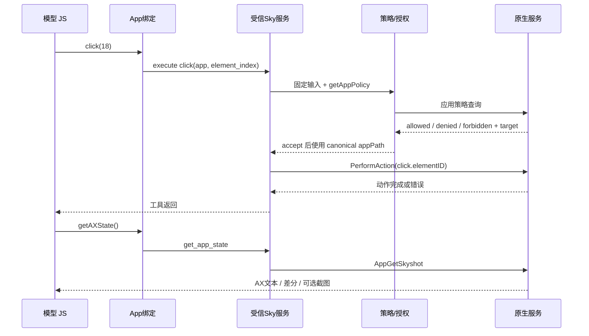

# 本机 Codex Computer Use：设计、底层机理与复现

分析日期：2026-11-04，Asia/Shanghai。对象：本机安装的 ChatGPT.app 所承载的 Codex 桌面功能。

## 1. 主要结论与证据范围

本机 Computer Use 的关键设计是：**模型生成 JavaScript，通过持久 REPL 操作统一 CUA 对象；CUA 将原生应用与浏览器分别路由到受信服务；服务把系统或浏览器状态变成带索引的 AX 文本，执行动作后再返回新状态，必要时补充截图。**

这套实现中值得复现的核心包括持久对象、受信执行边界、语义元素到真实目标的映射、差分观察、串行执行、权限决策和任务结束清理。截图与鼠标坐标是其中一条路径，AX 元素操作也是主要路径。

本报告把证据分为四类：

| 标记 | 含义 | 能支持的结论 |
| --- | --- | --- |
| C / B / P | 本机可读源文件、配置；详见 evidence.json | 当前安装版本的 JS 逻辑、协议、接口和配置 |
| N | local-inspection.json 中的原生导入符号、字符串与 ASAR 定位 | 使用的原生 API、模块及实现线索；不能单凭名字推导完整算法 |
| D | 本次通过正式 cua_repl 工具完成的计算器实验 | 原生索引操作、持久绑定、差分树、完整树和截图可运行 |
| T | test-results.json 与 source-validation.json | 原版 JS 的模拟协议行为、格式化 AST 一致性及阅读版语法 |

文中的“建议实现”“原型”“等价解释”指本次为了复现独立编写的内容。它们不属于恢复出来的 OpenAI 原始源码。对原生服务的分析止于公开可见的 Mach-O 元数据、导入符号与字符串；没有把反编译猜测当成确定结论。

官方说明只用于核对产品边界：macOS Computer Use 需要屏幕录制和辅助功能权限，应用访问还受独立控制；这些与本机实现证据相符。[官方 Computer Use 文档](https://learn.chatgpt.com/docs/computer-use)

## 2. 本机样本与组件布局

### 2.1 版本指纹

| 组件 | 采样结果 | 来源 |
| --- | --- | --- |
| 操作系统 | macOS 27.2，Build 26B123，arm64 | sw_vers、uname |
| 宿主应用 | /Applications/ChatGPT.app | 本机文件系统 |
| 宿主产品版本 / Build | 26.1029.61003 / 24614 | P04 Info.plist |
| unified-computer-use 插件 | 26.1029.61003 | P01 / P02 |
| Computer Use 功能插件 | 1.0.1001730 | 本机插件元数据 |
| 定制 Node 运行时声明 | 24.22.1-cua.1；二进制版本声明 24.22.1 | P03 manifest.json |
| @oai/cua | 0.2.6 | package.json |
| @oai/cua-repl | 0.1.3 | package.json |
| @oai/sky | 0.7.17 | package.json |
| @oai/browser-desktop | 0.1.1 | package.json |
| 原生服务 | com.openai.sky.CUAService；26.1027.1001730 / 1001730 | P05 Info.plist |
| 原生服务最低系统声明 | macOS 14.4 | P05 LSMinimumSystemVersion |
| 原生 IPC API | CodexComputerUseIPC-5 | C07 |

宿主、插件、JS 包与原生服务各自有版本，排错时需一起记录。宿主升级不等于这些编号必然一致。模拟测试使用本机普通 Node v24.22.2；正式 CUA 则按插件配置进入专用运行时。

### 2.2 文件布局

```text
/Applications/ChatGPT.app/Contents/Resources/
  app.asar                         Electron 宿主逻辑
  native/
    browser-use-peer-authorization.node
    sky.node                       宿主原生能力，未将其与完整 Sky 服务混为一谈
  cua_node/
    bin/node                       定制 Node
    bin/node_repl                  独立 REPL 可执行文件
    lib/node_modules/@oai/
      cua/                         模型侧统一 API 与内嵌代理代码
      cua-repl/                    REPL 启动环境与工具说明
      sky/                         受信桌面服务 JS、原生服务包
      browser-desktop/              浏览器 client/service 与 AX WASM

~/.codex/plugins/cache/openai-bundled/
  unified-computer-use/<version>/.mcp.json
  unified-computer-use/<version>/.codex-plugin/plugin.json
  computer-use/<version>/.codex-plugin/plugin.json

~/.codex/computer-use/Codex Computer Use.app/
  Contents/MacOS/SkyComputerUseService
  Contents/SharedSupport/
    SkyComputerUseClient.app
    CUALockScreenGuardian.app
    Codex Computer Use Installer.app
```

`@oai/cua` 中还包含一份 Sky 代理代码；本次比较 `sky.js` 和 `sky_service_rpc.js` 与 `@oai/sky` 中对应文件完全一致。实际应依据 import 路径确认所处层次，不能因存在重复文件就认为同一能力会执行两遍。

## 3. 架构和执行边界

```mermaid
flowchart TD
  M[模型规划与生成 JS] --> TOOL[cua_repl.js / MCP 工具入口]
  TOOL --> REPL[持久 JavaScript 会话]
  REPL --> API[globalThis.cua / App 与 Tab 绑定]
  API --> RPC[nodeRepl.rpc 受信服务桥]
  RPC --> SKY[@oai/sky/service]
  RPC --> BROWSER[@oai/browser-desktop/service]
  SKY --> POLICY[应用策略与授权询问]
  POLICY --> PIPE[原生 pipe / JSON-RPC]
  PIPE --> NATIVE[SkyComputerUseService]
  NATIVE --> AX[macOS AX 与窗口捕获/输入能力]
  BROWSER --> BROKER[宿主浏览器访问与权限层]
  BROKER --> IAB[内置浏览器]
  BROKER --> EXT[浏览器扩展]
  BROWSER --> CDP[CDP / AX / DOM / 截图]
  AX --> OBS[AX 文本 / 差分 / 截图]
  CDP --> OBS
  OBS --> M
```

图表示从源码整理的功能关系。它不声明每个框都对应一个独立 OS 进程；例如受信服务如何被 node_repl 调度，其完整进程隔离方式还需进一步审计该可执行文件。

### 3.1 为什么要持久 REPL

第一次调用可以保留 `let calculator = await cua.getApp(...)`，之后直接调用 `calculator.click(...)`。绑定对象封装了应用身份，浏览器对象还关联浏览器、会话与标签页。

这降低了模型重复构造参数的成本，使一次工具调用可以包含“多个确定动作 + 一次状态读取”。`js_reset` 重置 JS 绑定，但工具说明明确区分 JS 会话重置与真实应用/标签页状态；后者不会因此自动消失。

### 3.2 为什么模型侧代码不能直接持有系统能力

C04 中 Sky 代理通过 `nodeRepl.rpc("sky", ...)` 请求服务；C14 负责 RPC 包装。C05 只分派服务公开的方法。浏览器 client 也要求 `nodeRepl.rpc`，随后调用 `browser` 服务。

P01 配置的受信服务表为：

```json
{"browser":"@oai/browser-desktop/service","sky":"@oai/sky/service"}
```

原生管道由受信服务通过 `nodeRepl.nativePipe.createConnection` 使用。原版模块在缺少此桥接时会报错；在普通 Node 中只 import 包，并不会自动取得 Codex 的正式授权和系统访问。

本次模拟测试构造的是内存中的假 socket，不连接真实服务。该做法验证的是 JS 逻辑，不是获得原生服务权限的办法。

## 4. 插件启动、说明注入与任务生命周期

### 4.1 当前实际启动入口

P01 的 `.mcp.json` 将 `cua_repl` 配为 `/bin/sh` 启动，再 exec：

```text
/Applications/ChatGPT.app/Contents/Resources/cua_node/bin/node_repl
```

关键配置：

| 项 | 作用 |
| --- | --- |
| NODE_REPL_NODE_PATH | 指定专用 Node |
| NODE_REPL_NODE_MODULE_DIRS | 定位应用内附带模块 |
| NODE_REPL_TRUSTED_CODE_PATHS | 受信代码路径配置 |
| NODE_REPL_TRUSTED_SERVICES | 声明 browser / sky 服务 |
| CUA_REPL_ENABLED_SURFACES | 本次为 browser,computer |
| NODE_REPL_JS_BANNER | import("@oai/cua/tinyskyAlt") |
| SKY_CUA_SERVICE_PATH | 已安装的原生服务包路径 |
| BROWSER_USE_AVAILABLE_BACKENDS | 本次配置 chrome,iab,mcpapps |
| NODE_REPL_UNTRUSTED_ENV_ALLOWLIST | 限定向非受信侧暴露的环境项 |
| BROWSER_USE_ACCESS_* | 宿主访问桥的执行者与身份上下文配置名 |

C17 是包内另一条用于组装启动环境的实现，可用于理解约定；不能把它误称为本次一定先执行过的入口。当前插件直接调用 `node_repl`，并已经提供所需环境。

### 4.2 首次使用自动返回文档

C01 校验 surface，只接受 `browser` 和 `computer`，然后创建 `cua`。C02 根据启用面构建 API，C13 缓存、串行输出核心文档与每个浏览器的文档。

这解释了本次动态调用为什么先返回大量 API 说明，再返回计算器的 AX 树。工具说明可以随当前环境和后端能力变化；复现时应让模型先获得实际可用接口，避免只有固定提示词而接口已漂移。

`rewriteDocumentation()` 会按当前请求上下文重新输出已经加载的文档，服务于上下文压缩后的恢复。它与重新创建真实应用会话是两件事。

### 4.3 结束与中断

P02 注册 Stop、Interrupt、SubagentStop，调用 `turn_ended`。P01 还提供 `completion_summary` 的工具约定，用于将一串 UI 操作汇总到产品界面。

这些配置能证明存在生命周期通知，不能仅据此断言所有底层资源都在该钩子中同步销毁。复现时仍需明确释放按键、拖动、临时文件、截图句柄和会话占用，并把取消传播到等待中的请求。

## 5. 原生应用的完整调用链

以本次成功执行的 `calculator.click(18)` 为例：

1. C02 的 `getApp("com.apple.calculator")` 调用 `get_app_state`，要求初次完整状态，然后返回 C03 构造的应用绑定。
2. C03 将 `click(18)` 转成 `{app, element_index:18}`；坐标参数则转成 `x/y`。
3. 模型侧 Sky 代理通过受信 RPC 执行对应方法。
4. `targets/mac/click.js`（C16）进入 `withComputerUsePolicy("click", input, callback)`。
5. C06 固定输入、查询应用策略、完成授权，并把应用名规范为策略返回的实际 appPath。
6. C07 把动作转成 `ComputerUseIPCAppPerformActionRequest`，元素索引编码为字符串形式的 Swift 枚举关联值。
7. C08 取得已连接的 transport，通过带长度头的 JSON-RPC 发送请求。
8. 原生服务执行应用操作。之后显式调用 `getAXState()`，经同一权限入口得到新 Skyshot。
9. C09 整理 Skyshot 文本和可选截图 URL；C03 自动输出文本，截图路径则读取字节后输出图片。



C03 中还有几个容易漏掉的参数差异：原生应用 `typeText(text)` 与浏览器 `typeText(elementIndexOrNull,text)` 签名不同；统一 API 的 `durationMs` 会除以 1000 传给底层；macOS scroll 使用 pages，传 pixels 对象会直接拒绝。这些已经被 T 测试覆盖。

## 6. 原生 IPC 协议

### 6.1 连接地址与服务拉起

C08 优先读取 `SKY_CUA_SERVICE_NATIVE_PIPE_PATH`；否则默认地址为：

```text
~/Library/Group Containers/2DC432GLL2.com.openai.sky.CUAService/IPC/computeruse.sock
```

顺序为：先在约 250ms 预算内尝试连接并 ping；若不可用，优先通过 `NODE_REPL_HOST_SERVICES_PIPE_PATH` 请求宿主 `ensureService`，没有该入口时通过受信 Launch Services 桥打开服务应用；随后在约 5 秒启动预算内重试连接，每轮之间约 100ms。

服务路径的选择包括显式 `SKY_CUA_SERVICE_PATH`、`CODEX_HOME/computer-use/Codex Computer Use.app` 和 bundle identifier。宿主 ASAR 也包含托管服务 PID、可执行路径检查、串行启动与失效服务替换逻辑，见 local-inspection.json 对应条目。

### 6.2 分帧

Sky 原生协议的帧格式由 C08 明确给出：

```text
+---------------------------+---------------------------------+
| 4 bytes uint32 little-endian | N bytes UTF-8 JSON             |
+---------------------------+---------------------------------+
```

长度按 UTF-8 字节计算，最大单帧为 8,388,608 字节。接收缓冲区必须同时处理半个头、半个消息、多个消息粘在一起以及多字节 Unicode 被切开的情况。

浏览器服务有另一套通用 native pipe 实现：代码按宿主字节序选择 LE/BE，在本机 arm64 上为 LE，默认上限同为 8 MiB。不要把两套独立实现的细节写成全平台完全相同。浏览器分帧摘录见 B-cs / B-pb。

### 6.3 握手

```json
{"id":1,"jsonrpc":"2.0","method":"ping","params":{"clientApiVersion":"CodexComputerUseIPC-5"}}
```

客户端检查返回的 `serverApiVersion` 必须严格相等。版本不匹配属于明确错误；反复重试不能解决协议版本问题。

### 6.4 动作请求

以下是 T 测试由原版客户端生成的请求结构示例：

```json
{
  "id": 2,
  "jsonrpc": "2.0",
  "method": "request",
  "params": {
    "clientApiVersion": "CodexComputerUseIPC-5",
    "codexTurnMetadata": {"call_id":"mock-call","turn_id":"mock-turn"},
    "deadlineUnixMilliseconds": 1793764163845,
    "requestType": "ComputerUseIPCAppPerformActionRequest",
    "request": {
      "app": "mock.calculator",
      "action": {
        "click": {
          "at": {"elementID":{"_0":"18"}},
          "clickCount": 1,
          "mouseButton": 0
        }
      }
    }
  }
}
```

deadline 为本次采样时的数值；复验时须按当前时间动态生成。`_0` 等字段来自当前序列化约定，不能在复现时擅自拍平成另一个结构。

| requestType | 功能 |
| --- | --- |
| ComputerUseIPCAppPolicyRequest | 查询应用策略 |
| ComputerUseIPCAppGetSkyshotRequest | 获取应用 AX / 截图状态 |
| ComputerUseIPCListAppsRequest | 列举应用 |
| ComputerUseIPCAppPerformActionRequest | 点击、拖动、键盘、粘贴、设值、选文本等 |
| ComputerUseIPCAppStartRequest | 应用启动请求；更低层 client 提供此方法 |
| ComputerUseIPCStartAudioRecordingRequest | 音频录制，另有能力开关及授权 |
| ComputerUseIPCStopAudioRecordingRequest | 停止音频录制 |

能力存在于低层 client，并不保证都暴露在当前 `cua` 的模型接口上。

### 6.5 串行化、超时与失败处理

C08 用 Promise 链串行执行 `request`，每个 RPC 使用递增 id 和 pending Map 关联响应。默认动作 timeoutSeconds 为 120。连接关闭时 pending 全部失败，已关闭 transport 会从缓存中清除，以便下一次重新取得连接。

一个重要细节是：队列的请求预算在进入 request 时已计算，但 deadline 的绝对时间和发送侧定时器是在该请求实际出队发送时建立；不能把它描述为涵盖排队等待的端到端 120 秒截止时间。

取消、用户接管与服务错误具有独立语义。C10 的错误码包括：

| 错误 | 码 | 处理思路 |
| --- | --- | --- |
| senderProcessNotAuthenticated | -10000 | 检查调用者可信链，不能只改请求 JSON |
| appNotAllowed | -10006 | 正常应用访问控制 |
| permissionsNotGranted | -10009 | 检查 OS 权限 |
| userStoppedSession | -10012 | 结束当前操作 |
| incompatibleClientVersion | -10013 | 对齐版本 |
| permissionsPending | -10014 | 等待正常授权流程 |
| blockedURL | -10015 | 遵循网站策略 |
| userIntervened | -10016 | 重新读取状态，尊重用户接管 |
| ambiguousApp | -10018 | 使用明确身份解析目标 |
| screenLocked | -10020 | 明确锁屏支持边界 |

## 7. AX、截图、差分和目标映射

### 7.1 原生 AX

N 证据中存在 `AXUIElementCreateApplication`、属性读取、动作枚举、`AXUIElementPerformAction`、`AXUIElementSetAttributeValue`、`AXValueGetValue` 等导入。因此可以确定原生服务包含 macOS Accessibility 的应用级语义读写路径。

这条路径能表达按钮、文本、窗口、禁用状态、可设值属性和 secondary actions。本次真实树中出现了计算器按钮的 Description、Identifier、Value 和可用附加动作。

### 7.2 索引是观察结果的引用

数字 `18` 是工具给模型的短引用。它不是 macOS 的永久控件 ID，也不是屏幕坐标。底层仍需持有或恢复具体 AX 元素。

本次初始树中 `18` 是数字 1；操作后差分保留已有索引并分配 38、39 等新索引；再次要求完整树后，`18` 变成数字 6，数字 1 变成 `20`。因此在完整刷新之后复用旧数字会指向其他控件。

这证明“同一观察上下文中的差分维护”和“完整树重建”存在不同的索引行为。它不能证明所有应用每次完整刷新都会按同一规则重编号。

### 7.3 Skyshot 是组合观察结果

C09 要求响应中有 `skyshot` 对象，读取 `skyshot.text`，截图 URL 可为空；响应还可能携带应用专用说明，并在适当情况下只注入一次。

`getAXState()` 走 `get_app_state`；`getScreenshot()` 也走该入口后读取截图 URL；`getAXStateAndScreenshot()` 返回两者。不要仅凭函数名认定 `getAXState()` 在原生端绝不做截图工作，本次 JS 无法证明这一点。

### 7.4 截图底层

N 中可见 ScreenCaptureKit 动态依赖、`SCScreenshotManager`、`SCContentFilter`、`captureImageWithFilter:configuration:completionHandler:` 与窗口枚举相关导入，另有 SkyLight 捕获包装的字符串线索。

可以确认服务包含窗口过滤和图像捕获能力；尚不能确认每个窗口必定走哪一种路径、特殊窗口如何合成以及所有 fallback 条件。独立原型选择公共 ScreenCaptureKit 做窗口截图，是复现方案中的明确取舍。

坐标操作还必须保留窗口点坐标、图像像素坐标、缩放比例和窗口来源。不能用 Retina 截图像素直接当作全局桌面点坐标。

### 7.5 差分与 UI 稳定

本次返回了 `~` 修改、`+` 新增、Removed element IDs 范围压缩。原生字符串中也有 DifferenceBaseline、RefetchableSkyshotAXTree、UIElementRenderDifference 和 `needsUISettleBeforeSkyshot` 等线索。

可确定存在状态差分和交互后等待稳定的设计。具体稳定算法、等待时长、树裁剪预算、摘要阈值与稳定身份算法尚未恢复。原型可先采用有界遍历、一次完整观察、动作后失效，再逐步实现稳定身份与差分。

### 7.6 后台控制的已知与未知

官方说明 macOS 支持后台使用。本机包含 VirtualCursor、窗口预览和定向事件包装的线索，AXPress 本身也能针对应用元素发动作。[官方 Computer Use 文档](https://learn.chatgpt.com/docs/computer-use)

但是本次没有设置“前台输入持续进行”的对照实验，也没有恢复坐标点击最终进入哪个私有系统调用。不能据此宣称“后台控制完全等于 CGEventPostToPid”，更不能认为所有 App、菜单、输入法和拖动都能以公共 API 同等复现。

## 8. 浏览器后端的机制

### 8.1 统一外观，按能力分支

C11 的 Tab 包装会优先使用 `tab.ax`。若该能力不存在，则观察可走 `playwright.domSnapshot()`，截图可走 tab screenshot API；原生式输入包装会拒绝并要求使用该后端文档列出的 Playwright API。

因此 `getAXState()` 在 DOM-only 后端上可能返回 DOM 快照，没有原生式数字索引。复现时应做能力协商，不能把整个 Tab 接口视为所有后端均可用。

### 8.2 AX 树从哪里来

B02 / B03 的实际代码调用：

```text
Page.getFrameTree
DOMSnapshot.captureSnapshot
Accessibility.getFullAXTree
DOM.getFrameOwner
```

它同时收集 Frame、目标会话、DOM 元数据与 AX 节点，并处理多 Frame 的关联。浏览器可见文字与可交互语义由此得到，并不需要假设先对整张截图做 OCR 才能操作普通按钮。

### 8.3 WASM 的作用

browser-service 实际加载 `browser-accessibility.wasm.br`，实例化 WebAssembly，校验一组导出，包括 revision 创建、文字长度/复制、元素身份与可设值查询。

从 JS 调用点可确定 WASM 用于 AX revision 的构建、文本化及元素身份查询。`targetForElement` 先从 revision 将数字索引转成 identity，再从 targets Map 找真实节点，并检查文档的 Frame/loader 身份；旧页面引用会被拒绝。

WASM 内部具体实现语言、完整差分算法和所有排序规则没有因 JS 中出现 WASM 就自动确定。本次未反编译这个二进制。

### 8.4 动作如何落地

B00 的原版实现中存在 `Input.dispatchMouseEvent`、`Input.dispatchKeyEvent`、`Input.insertText`、`DOM.scrollIntoViewIfNeeded`、`DOM.getContentQuads` 和 `DOM.getBoxModel`。

这支持“元素语义定位 → Frame/DOM 目标 → 几何/焦点处理 → 浏览器输入事件”的具体路径。不同动作还会涉及命中测试、可见性、对话框、跨 Frame 和剪贴板桥，不能把它缩减为简单查询 CSS 后调用 DOM click。

### 8.5 标签页身份与认领

C12 区分 managed tabs 和用户已打开的 tabs，必要时调用 claimTab。按 URL 找既有标签页时要求明确浏览器；多个匹配结果会报错。标签页 mention 还校验标题和 URL，避免继续操作已经变化的旧引用。

创建 Chrome 会话时的 sessionName、IAB 的 visible 设置在创建标签页前应用。页面创建、访问授权、控制归属和 UI 可见性分别有自己的语义。

## 9. 权限、身份和信任设计

### 9.1 应用授权入口

C06 的主要顺序为：复制并固定输入 → 查询策略 → 处理 allowed/denied/forbidden → 由受信桥创建授权询问 → 确认 accept → 使用规范化 appPath 执行动作。

`allowed` 是应用策略允许进入授权流程；它不意味着所有情况下都省略用户授权。已保存的决定可由宿主返回，包装层也识别 persisted-state 来源。

### 9.2 为什么检查 plain data property

代码用 `Object.getOwnPropertyDescriptors` 检查输入属性，拒绝 getter/setter，复制为不可写属性后冻结。这样可以减少“查询时的 app 与执行时的 app 因 getter 而变化”的问题。

该实现是浅层复制/冻结，不应描述为对任意嵌套对象完成深度不可变或消除全部 TOCTOU。被保护的关键 app 参数在策略后还会替换为规范化路径。T 测试验证了 getter 不被调用、callback 看到冻结对象，以及被组织策略拒绝时不进入批准回调。

### 9.3 OS 权限与进程认证

屏幕录制、辅助功能授权和应用许可属于不同层面。原生导入及错误码中还存在调用进程认证、audit token 与 Security 代码身份查询证据。

宿主的 `browser-use-peer-authorization.node` 和对应 ASAR 调用点包含 socket peer 授权；静态字符串包含 LOCAL_PEERTOKEN、signing identity 和父进程相关检查线索。ASAR 中是否启用该路径还取决于平台和构建配置。没有本次实际 peer 审核日志，不能把条件分支一概写成每个请求均经过的完整流程。

复现自己的系统应使用自己的进程身份、正常 OS 授权与服务边界。复制插件环境变量只能复制配置，不能等价复制受信身份。

### 9.4 网站与开发者能力

浏览器源码把 origin、download、upload、full_cdp、webmcp 等资源区分管理。内部为完成受控动作而使用 CDP，不意味着模型自动获得任意 CDP 访问；源码中另有 full CDP 的权限入口。

官方浏览器文档也区分普通交互、站点权限与更高权限的开发者能力。[官方 Browser 文档](https://learn.chatgpt.com/docs/browser)

### 9.5 可观察性

C06 包含策略、授权等待、原生执行的 span，以及应用标识、工具名、耗时和终态字段。C08 还透传回合 metadata。

这些代码支持追踪“哪次工具操作在什么阶段失败”。本次没有抓取网络 telemetry，不能由字段存在推断所有数据实际发送、保留位置或保留期限。

## 10. 本次动态实验与结果

### D01：真实计算器

第一次尝试被用户中断，没有算作成功测试。用户要求继续后，使用正式接口完成：

```javascript
let calculator = await cua.getApp("com.apple.calculator");
// 首次返回完整 AX 树；从实际树读到数字 1/加/数字 2/等于的索引。
await calculator.click(18);
await calculator.click(21);
await calculator.click(19);
await calculator.click(25);
await calculator.getAXState();
await calculator.getAXStateAndScreenshot({ disableDiffing: true });
```

上述数字只适用于本次初始树，不能直接硬编码到另一台机器或另一次状态中。

结果：差分显示表达式 `1 + 2`、输入值 `3`；完整树和工具返回的窗口截图均确认结果为 3。随后按工具约定发出一次完成摘要。

工具报告本次绑定/首次读取约 7.676 秒，四次点击加差分约 0.844 秒，完整树加截图约 0.144 秒。这些是单次工具墙钟时间，受启动、授权、缓存和环境影响；不能作为延迟基准或产品 SLA。

### T01：原版 JS 内存模拟测试

`reproduction-tests.mjs` 直接导入安装包中的原版函数。它将 nativePipe 替换为纯内存 EventEmitter socket，验证客户端真正编码出来的消息。执行结果见 test-results.json：

1. 多字节 UTF-8、逐字节分片和多个粘连帧。
2. 8 MiB 上限拒绝与不完整头保留。
3. 原版 client 的版本 ping、Swift 枚举请求结构与单连接请求串行化。
4. App 绑定的毫秒转秒、固定 app 与平台参数约束。
5. 实际权限包装的规范化应用路径、冻结输入和组织拒绝。
6. accessor 输入被拒绝且 getter 没有执行。
7. 连接关闭时挂起请求失败。

这些测试不证明真实 OS 事件、完整服务认证或所有原生动作正确；这些能力需分别测试。

### T02：提取材料校验

18 个纯格式化文件的 AST 与安装包原文件一致，忽略位置、注释和原始字面量格式等非语义元数据；18 个改名阅读版均可被解析。文件 hash 可用于确认采样对象。

改名阅读版的可读名称由本次按 AST 作用域生成，不代表恢复了作者原始变量名。没有声称编译型原生服务也取得了同等源码级证据。

### T03：独立原型的构建检查

`mac-ax-bridge.swift` 在本机使用 swiftc 编译通过，`--self-test` 通过整数参数校验。见 native-prototype-validation.json。未运行该独立原型的桌面读取、动作或截图，OS 授权与 GUI 行为仍需操作者按路线 C 复验。

## 11. 可复现的三条路线

### 路线 A：在当前 Codex 环境复验产品能力

使用 `cua_repl` 正式入口，先选定一个无业务副作用的测试应用，再读取实际树，选择元素，动作后重新观察，最后使用截图核验。计算器是本次已跑通的样例。

验收：AX 结果与截图一致；完整树刷新后重新取得索引；中断或用户接管后停止旧动作；不在两个任务中同时控制同一应用。

### 路线 B：复验逆向结论

在资料目录运行 README 的三条命令：模拟原版协议测试、只读采样、重新提取代码。比较 evidence.json 和新的哈希，再查源文件中对应结构。

提取过程借用应用内 Playwright 附带的 Babel。在 scratch 副本中导出其内部 Babel core，再进行无插件格式化与作用域改名；没有修改安装文件。当前 Playwright 内部绑定名是 `nd`，未来包更新可能变化，脚本会需要适配。该名字属于格式化工具的实现细节，不是 Computer Use 机制。

### 路线 C：独立实现最小 macOS 版本

已提供 `mac-ax-bridge.swift`。它用公共 API 独立实现一个应用绑定的串行 JSONL 服务：

| 能力 | 原型实现 |
| --- | --- |
| 目标身份 | 启动参数指定 bundle id；只访问已运行、唯一匹配的应用 |
| AX 观察 | AXUIElementCreateApplication，读取角色/标题/描述/值/Identifier/动作 |
| 有界遍历 | 深度、节点数量与总遍历时间预算；保留 truncated 标志 |
| 目标引用 | 观察返回 revision + index，动作校验 revision 与应用 PID |
| 动作 | AXPress、AXValue 设值；动作后引用立即失效 |
| 图像 | ScreenCaptureKit 过滤目标应用的普通窗口；保存 PNG 与尺寸元数据 |
| 调用面 | stdin/stdout，一行一个 JSON；没有网络端口和任意代码执行 |

编译与运行命令见 README。示例输入：

```json
{"id":1,"method":"observe"}
{"id":2,"method":"press","revision":1,"index":18}
{"id":3,"method":"observe"}
{"id":4,"method":"screenshot"}
```

index 和 revision 必须来自真实响应。示例中的 18 只是占位。若 observe 失败或没有该索引，第二条必须调整。每次动作后先 observe，再决定下一步。

该原型主动在动作后失效所有索引，比当前产品允许批量使用同一观察下多个引用更保守。它只做完整树，不实现产品的稳定索引差分；JSONL 也不是 Sky 的长度分帧协议。两者便于分开理解，不能直接把原型接到 Codex socket 上。

当前原型只选择第一个匹配的普通窗口。多窗口产品应改成显式 windowID 绑定。时间预算是在节点之间检查，不能硬中断单次阻塞的 AX 调用；生产版本应增加 AX messaging timeout 和进程级取消。截图缩放为原型显式选择，不代表恢复了产品的缩放策略。

### 把原型接到模型

官方 API 将环境执行交给应用侧，可选择代码执行或结构化动作回路；这为独立实现提供公开接入路线。[官方 Computer use API 指南](https://developers.openai.com/api/docs/guides/tools-computer-use)

一个可实现的控制循环为：

```text
创建持久 task session，确定允许的 App/窗口
    ↓
observe → 保存 snapshot/revision → 发送 AX 文本，必要时发送截图
    ↓
模型输出一个受限 action 或一小段经隔离执行的代码
    ↓
服务检查 task/app/window/revision/权限/取消状态
    ↓
执行动作 → 等待有界稳定 → 再 observe
    ↓
验证目标结果；完成、继续或交回用户
```

初版建议直接把 JSON action 作为工具输入，先验证观测和动作质量。需要批量化后再引入代码执行器；Node vm 单独使用不足以形成安全隔离。生产执行器应具有独立的 OS 隔离、有限能力桥、任务截止时间和资源预算。

## 12. 生产级复现还需补齐什么

| 子系统 | 具体工作 | 验收方式 |
| --- | --- | --- |
| 观察质量 | 去重、树裁剪、输入敏感字段策略、隐藏/失效元素处理 | 在多种桌面框架中检查可定位性与遗漏率 |
| 稳定引用与差分 | 平台身份 → 稳定内部 key → 当前索引，导航/进程变化后失效 | 重排、列表虚拟化、完整刷新、跨窗口后不误击 |
| 输入执行 | AXPress/AXValue 优先；坐标 fallback、键盘组合、IME、拖动 | 确认目标命中和真实业务状态；失败时无重复副作用 |
| UI 稳定 | 有界等待、动画/加载/弹窗观察、超时与取消 | 不依赖固定 sleep，慢 UI 可恢复 |
| App/窗口选择 | 规范化身份、处理多实例、显式窗口绑定 | 前台变化和应用重启不会串到其他目标 |
| 浏览器适配 | Frame/OOPIF、AX+DOM 元数据、CDP 输入与导航身份 | 跨源 iframe、刷新、对话框、重定向后旧引用失效 |
| 服务边界 | 每任务能力、调用者认证、OS 权限与应用授权 | 非授权进程、过期会话及错误目标均被拒绝 |
| 并发与生命周期 | 应用/窗口租约、串行队列、取消、释放按键和拖动 | 用户接管、中断、服务崩溃后无继续输入 |
| 可观察性 | 请求 id、阶段耗时、受控日志、状态指纹、截图引用 | 能区分模型误判、过期观察、执行失败和页面变化 |
| 模型回路 | 上下文预算、文档注入、错误反馈、最终验证 | 以任务成功率及误操作率验收，不能仅统计点击成功 |

不建议从锁屏自动解锁开始复现。安装包中的 Guardian 和授权插件证明该功能还涉及独立系统集成，它不是最小观察/动作闭环的前置条件。本次没有运行锁屏、安装授权插件或更改系统保护。

## 13. 尚未确定的问题

本次没有恢复模型权重、训练方式、后端推理服务、模型内部视觉表示或完整提示编排，也没有证明某个模型性能优于另一个模型。

原生输入的最终系统调用、所有后台焦点处理、遮挡窗口合成、精确差分与 UI 稳定算法、锁屏守护/解锁细节、完整 socket 调用者可信链与生产 telemetry 流量仍未完成源码级验证。

没有以真实业务 App 做大规模兼容性或可靠性评测。计算器证明当前路径可运行；内存测试证明指定 JS 行为；这两类证据不应扩展成完整产品复制已完成。

## 14. 如何回查证据

先在 [核心代码导读](核心代码导读.md) 找功能，再打开 `core/readable/` 对应文件。需要核对改名时对照 `core/formatted/`。`evidence.json` 保存每个模块的原路径和 SHA-256。

浏览器 bundle 使用 `evidence.json` 中的 UTF-8 字节 offset 定位，避免在极长的压缩单行中引用失效的行号。`core/browser-excerpts.txt` 的范围是格式化后文本的字符位置，不能与原始字节 offset 混用。

原生证据在 `local-inspection.json`：undefined symbols 来自 Mach-O 符号表；字符串保留二进制字节位置；ASAR 条目保留内部路径、条目 hash 和条目内 byte offset。字符串存在证明编译产物包含该名称，不单独证明对应代码在本次实验里被调用。
