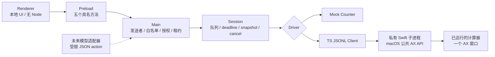
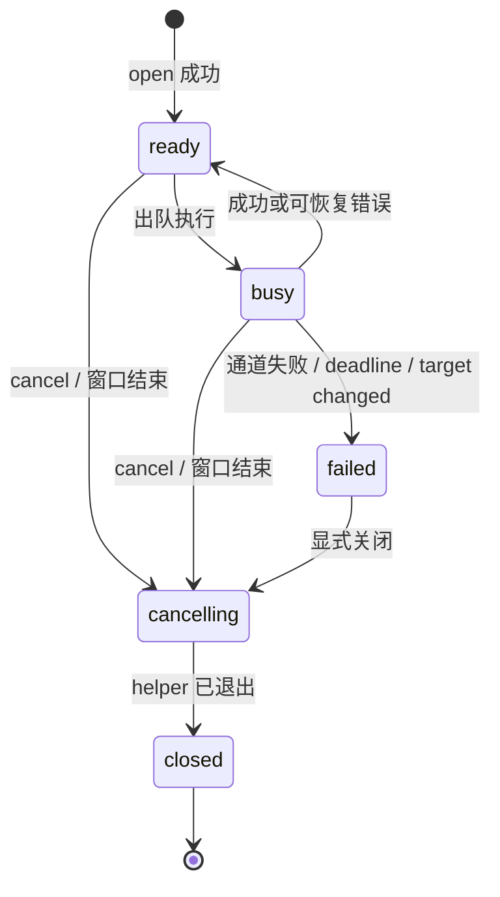

# TS + Electron Computer Use 工程设计

本方案把上一轮的可复现机制转为独立模块和接口。v1 的验收目标是“选择一个允许应用 → 完整观察 → 基于本次快照执行一个动作 → 重新观察并核对结果 → 取消释放”。参考工程提供真实 Electron UI、Mock 驱动与 macOS AX 驱动；模型与浏览器留在后续阶段。

## 1. 进程与信任边界



Main 和 Session 都是受信工程代码；Swift 负责阻塞的 AX 调用，因此不把 AX 遍历放在 Electron UI 线程。Mock 仅用于工程验证。没有引入额外的 utilityProcess：这层可在驱动协调逻辑变重时再添加。Electron 的 utilityProcess 具备 Node 能力，因此也不能直接作为任意模型代码的安全沙箱。[utilityProcess 官方说明](https://www.electronjs.org/docs/latest/api/utility-process)

Renderer 只加载本地 `cu-app://ui/index.html`，显式使用 `nodeIntegration:false / contextIsolation:true / sandbox:true`。Main 检查 sender WebContents、主 frame 及精确 URL，拒绝页面导航、新窗口、webview 和权限请求；资源协议仅允许三个固定静态文件。以上边界参考 Electron 的官方安全建议。[Electron Security](https://www.electronjs.org/docs/latest/tutorial/security)

Preload 打包为**单个 CommonJS 文件**，只 require Electron，避免沙箱 preload 加载本地相对模块或 ESM 的兼容问题；Renderer 单独构建浏览器 bundle。[Electron ESM 限制](https://www.electronjs.org/docs/latest/tutorial/esm)

## 2. 数据契约与能力

完整类型在 `src/shared/contracts.ts`。契约的关键字段如下。

| 对象 | 字段 | 语义 |
|---|---|---|
| Target | driver、bundleId、displayName | Main 从固定允许列表选择，不信任 Renderer 传来的 displayName/path |
| SessionInfo | id、target、state、capabilities | 会话属于创建它的窗口；id 本身不等于授权 |
| Observation | sessionId、snapshotId、revision | session 是权限/生命周期作用域；UUID 是动作引用身份；revision 是显示和诊断序号 |
| Observation | processId、capturedAt、text、nodes、truncated | 诊断进程、采样时间、AX 全量文本与节点、裁剪标志 |
| ElementRef | snapshotId、index | index 只能在指定 snapshot 内解释，不能持久保存 |
| Action | press(ref) / setValue(ref,value) | 只暴露首版支持的动作，不接收命令、路径或任意 JS |
| ActionReceipt | performed、observeRequired | 驱动返回动作成功；业务目标仍需从新观察验证 |
| Failure | code、message、outcome | `not-started / unknown`；结果未知时不能自动重试有副作用动作 |

v1 能力：完整 AX、AXPress、AXValue。`diff / screenshot / coordinates / backgroundInput` 均为 false。不要因操作系统具备某项能力就把它声明为本驱动已支持。

### 运行时校验

校验位置分别是：Main 的 IPC 入站、Session 的 action 入站、TS 客户端收到的 native envelope/结果。`record()` 检查自有属性描述符，拒绝 accessor、未知字段和 symbol 字段；action 的 ref 复制冻结，限制字符串长度和索引范围。观察节点检查数量、唯一 index、深度与字符串长度。进程间消息使用普通可复制数据。

这是一份小型协议的手写校验实现。迁入已有 Zod/Valibot 项目可用 schema 替换，但须保留严格字段、上下界、错误语义与回归测试。TS 类型和 `as Action` 都不能代替校验。

Native 响应里的错误 code 仅接受固定集合；未知错误映射到通道失败。Main 对 UI 返回 `Result<T>`，不依赖跨桥复制自定义 Error 属性；Electron 的 contextBridge 对 Error 自定义属性有复制限制。[contextBridge 类型支持](https://www.electronjs.org/docs/latest/api/context-bridge)

## 3. IPC 与原生协议

### Renderer → Main

| 方法 | 通道 | 入参 | 成功结果 |
|---|---|---|---|
| targets | cu:targets | 无 | Target[] |
| start | cu:start | driver、bundleId | SessionInfo |
| observe | cu:observe | sessionId | Observation |
| act | cu:act | sessionId、action | ActionReceipt |
| cancel | cu:cancel | sessionId | closed:true |

五个通道均经过 Main 的 sender 检查。start 还检查目标允许列表，macOS 会话调用 Main 的授权对话框；后续动作复用该会话决定，不重复询问。取消不排在 observe/act 队列之后。界面只暴露这五个操作，没有 `invoke(channel, ...)`、命令行执行器或全量 CDP。

### TS → Swift

每个会话独占一个 helper 进程与其 stdin/stdout。协议是“一行一个 UTF-8 JSON 对象”，不是 Sky 的长度前缀协议。

```json
{"id":1,"method":"hello"}
{"id":1,"result":{"protocol":"cu-reference/1","bundleId":"com.apple.calculator","processId":123}}
{"id":2,"method":"observe"}
{"id":3,"method":"press","revision":1,"index":7}
{"id":3,"result":{"performed":true,"observeRequired":true}}
```

例中的 PID/index/revision 仅为格式占位；实际动作必须使用 observe 返回值。helper 的 setValue 另带 value 字符串。

请求/响应最多 1 MiB，缓存按字节累计，凑齐换行后才以严格 UTF-8 解码。客户端最多一个 pending 请求，session 负责序列化。错误 id、非法 JSON、过大行、通道 EOF 或进程退出都会拒绝等待者并使通道终止。stderr 被消费，不转发任意内容到界面。

路径由 Main 从开发目录或 `process.resourcesPath/bin/mac-ax-bridge` 决定；使用 `spawn(executable,[bundleId],{shell:false})`，子进程只继承显式环境。helper 不监听端口，且自身再次限定 bundle id。该安排减少 IPC 暴露面；它不是对同用户恶意进程的完整 OS 隔离或可移植进程认证方案。

## 4. 会话、队列和快照



`ready` 在 open 之前是内部状态，对外仅返回 open 成功的 SessionInfo。Renderer 不接收持续状态事件，而用请求结果与取消维护显示；若产品需要进度订阅，应新增具名订阅并在 Main 过滤 owner、在 Preload 隐藏 Electron event，不能直接开放 IPC event 对象。

每个 Session 最多排队 32 项，observe 与 act 使用同一 Promise 链。截止时间在**请求进入队列时**生成，包含排队等待；真正执行只使用剩余预算。排队已过期的请求不调用 driver。执行中超时则会关闭 driver、让 session 进入失败状态并拒绝后续任务；不会继续在同一通道发动作。

每次 observe 先清除旧引用，成功后创建 snapshot UUID，并保存 nativeRevision。返回给调用者的是复制对象，防止进程内模型适配器改写内部快照。每次 act 必须匹配当前 snapshot 和真实存在的 index；执行尝试前清除快照。失败、完整重读、取消、进程重启都不能延续旧引用。

v1 没有实现稳定索引差分，因此不允许一个观察下连续批量点击多个按钮。重复提交相同快照动作，只有第一项能执行，后面的会收到 `STALE_SNAPSHOT`。这是本例的设计选择，不是声称原产品也使用相同失效策略。

**快照新鲜不等于界面静止。** 其他进程或用户仍可在 observe 与 act 之间改变界面；本例的 AX 引用、PID 和窗口检查能减少误用，不能证明虚拟化控件始终保持同一业务语义。重要操作需额外检查当前标签、状态或业务确认条件。

## 5. 取消、崩溃与恢复

取消先撤销会话的 AbortSignal，再绕过队列关闭 helper；客户端拒绝 pending、发送 SIGTERM，750ms 后仍未退出则发送 SIGKILL，并等待退出。Main 在 close 完成后才释放目标租约。窗口关闭、主 frame 导航/重载或渲染进程崩溃也会关闭所属会话。

授权或 helper 启动期间若窗口被关闭/重载，owner epoch 的变化会让启动失败，防止授权等待结束后遗留无主会话。原生 helper 不会在用户界面后台自动重建，必须取消旧会话，再显式 start → hello → observe。

取消阻止的是后续调度和对该 helper 的继续调用。已经送达操作系统或目标应用的动作可能仍产生结果；退出 helper 不能撤销已执行的按键或业务副作用。故超时/取消后的 act 采用 `outcome:unknown`，恢复后先观察、核验，再决定是否重做。当前无键盘按住/拖动能力，未来加入时还需输入释放的专门协议。

## 6. 原生驱动实现范围

`MacAXBridge.swift` 只使用公共 Accessibility API：

- hello 固定唯一目标进程；以后以 PID 和 launchDate 检查重启。
- observe 只接受恰好一个 AX window，遍历该窗口而非整个桌面或菜单栏。
- 遍历最多深度 24、1000 节点、3 秒软预算；单次 AX 消息使用 0.5 秒 timeout。总预算在节点之间检查，不能视为硬实时保证。
- AXSecureTextField 的值显示为 redacted，且不遍历其后代、不允许操作；其他敏感内容仍可能出现在普通 AX 字段，接入模型前需要产品级数据策略。
- press 使用 AXPress；setValue 先检查可写再设 AXValue；每次动作重查目标窗口和元素 PID，动作后索引失效。

v1 未设置有界 UI 稳定等待；UI 在动作返回后立即重新观察，若应用异步更新，需再次手动 observe。后续应按 AX 通知、目标值变化和有界轮询补齐稳定条件，并在等待中传播取消，不能将固定 sleep 当作完整解决方案。

原型截图没有带入本轮公开 API：上一轮仅以第一个窗口截图，无法保证与操作窗口一致。后续要先建立 AX window ↔ capture window 的明确映射，再返回 `windowID / boundsInPoints / imageSizeInPixels / scale / coordinateSpace`。在此之前，不把截图像素当作全局桌面点坐标。

## 7. 模型与浏览器如何接入

首版模型回路应位于受信应用服务侧，调用 Session，不经 Renderer 转发任意代码。建议流程：取得会话能力 → observe → 按预算组织 AX 内容 → 模型返回 action JSON → parseAction → Session.act → observe → 独立结果核验。API key 使用服务侧配置或系统凭据存储，不发到 Renderer；本工程未配置任何模型供应商或网络请求。

模型返回的 ref 必须来自当次观察；持续使用相同会话不等于复用旧快照。完成条件应表达业务状态，例如“计数值为 1”，不能把 `performed:true` 作为任务完成。上下文中的网页/AX 文本都是数据，不能赋予它们改变目标允许列表或运行命令的权力。

浏览器接入需要另扩 Target：browserId、sessionId、tabId、frame/document/loader 身份、origin 与租约；能力分别协商 AX、DOM snapshot、locator、截图、坐标输入。DOM-only 的文本观察不产生可用于 AXPress 的数字 ref。导航、跨 Frame、对话框、用户切换页面时必须失效对应引用。具体扩展说明在 `src/drivers/browser/README.md`。

## 8. 迁入现有 Electron 工程的顺序

先迁 shared + automation + Mock，保持当前项目的主构建工具；通过类型检查和会话测试。再将 Main handler 合入现有窗口和 session 管理，按真实应用 origin 检查 sender；Preload 合入具名 API，并保留单文件 CJS 的沙箱兼容条件。最后接入 helper、开发/打包路径和正常系统权限。

不要同时保留本例和现有项目的两套 `app.whenReady`/`protocol.handle`/`ipcMain.handle` 注册。现有多窗口应用需要将 owner 校验改为窗口注册表，而非直接删除检查。任务协调器如果新增多个实例，还必须把租约提升到唯一进程级服务，避免不同 Manager 各自允许控制同一目标。

## 9. 可观测性与后续阶段

本例仅在 UI 显示有限事件，未将 AX 内容写入持久运行日志。生产环境建议记录 requestId、sessionId、snapshotId、动作类型、阶段耗时、错误 code 与 outcome；按配置脱敏 target，默认不记录文本值、截图字节或整棵 AX 树。采样、保留期限和删除机制需要单独约定。

| 阶段 | 目标 | 进入条件 |
|---|---|---|
| 当前参考层 | 契约、Mock、Electron 桥、Swift 编译与 native 客户端 | 本次验证记录所列检查 |
| 原生试用 | 真 GUI、权限、异步 UI、多次取消、进程重启、用户接管 | 在真实桌面逐项复验 |
| 可分发版本 | 多架构 helper、签名、TCC、升级、应用路径、崩溃恢复 | 干净机器及升级回归 |
| 扩展能力 | 窗口选择、截图、稳定等待、差分、BrowserDriver、模型 | 每项独立能力与兼容测试 |

本工程是可检查、可构建的参考起点；真实桌面可靠性、签名分发和产品风险边界需要按照接入与验收文档继续验证。
