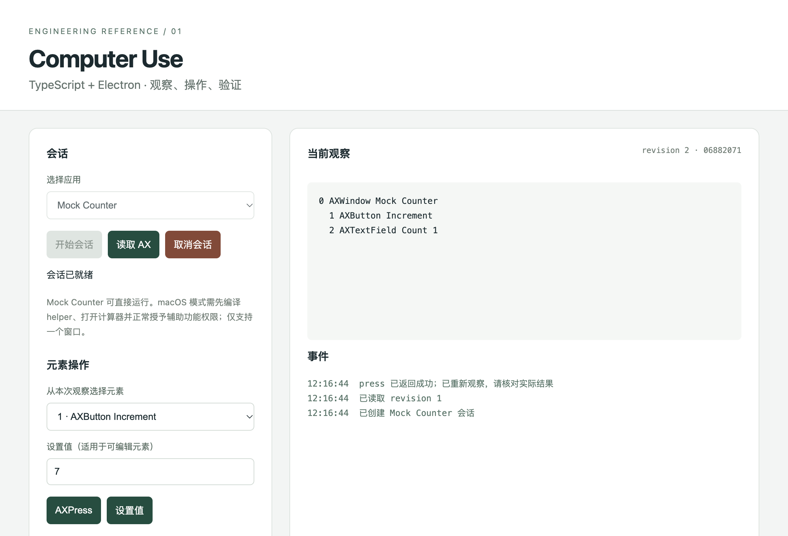

# 本次验证记录

日期：2026-11-04，Asia/Shanghai。对象：本轮独立参考工程；与上一轮 Codex 产品动态实验分开记录。

| 检查 | 结果 | 证据与范围 |
|---|---|---|
| TypeScript strict 类型检查 | 通过 | `npm run typecheck`，退出 0 |
| bundle 构建 | 通过 | Main、单文件 CJS Preload、Renderer、demo、测试 |
| Node 自动化测试 | 19 / 19 通过 | 输入/发送者谓词、快照/并发/超时/取消/租约、真实子进程 JSONL 故障模拟 |
| Mock CLI 闭环 | 通过 | observe → press → observe，断言 Count 从 0 变成 1，最后 cancel |
| 真实 Electron 集成 | 通过 | Renderer → Preload → Main → Mock；启动、观察、动作、新观察、取消 |
| Renderer 边界 | 通过所列检查 | sandbox=true、contextIsolation=true、nodeIntegration=false；Renderer 无 require/process |
| 真实其他窗口 IPC | 拒绝符合预期 | 同 origin 的另一窗口经同一 Preload 发 targets，返回 NOT_AUTHORIZED |
| 非法 IPC 负载/目标 | 拒绝符合预期 | 未知 command 字段被拒绝；任意 bundle id 被拒绝 |
| Swift helper 编译 | 通过 | 本机 `swiftc` 编译成功，生成 arm64 helper |
| Swift helper 自检 | 通过 | `--self-test`，仅整数校验，不访问桌面 |
| 真实 macOS AX observe / press / setValue | 未执行 | 需要正常 OS 授权与单窗口 GUI 验收 |
| 打包、签名、公证、升级与 TCC | 未执行 | 提供配置模板与验收项，未生成安装包 |
| 浏览器、截图、坐标、差分、自动接管检测、模型连接 | 未实现 | 能力对象或设计说明明确其范围 |

本次 Electron 实际运行版本为 45.2.1；Node 24.22.2、npm 11.19.1、TypeScript 7.0.2、esbuild 0.28.2。工程依赖最初从本地已有 npm 缓存构建；Electron runtime 使用本地已有同版本缓存包，仅供本轮验证，未随资料分发。

锁文件随后通过正常 npm registry 元数据补齐其他平台可选依赖；其他 OS/CPU 未做实际运行验证。Electron 界面测试及 Node 协议 fixture 的本次运行平台为 macOS arm64。

macOS GUI 测试在默认命令沙箱中于应用代码执行前以 SIGABRT 结束；随后在正常桌面权限环境运行本地 Mock 测试成功。整个测试保留了 Electron Renderer sandbox。它没有操作计算器或变更系统授权。

原始 Electron 结果见 [electron-smoke.json](electron-smoke.json)，截图见下。截图展示 Count 1 的验证后状态；画面中的 AX 树来自 Mock，不能作为真实 AX 能力证据。

## 测试清单

`boundaries.test.ts`：字段/范围/重复 index 校验、accessor 拒绝且不执行 getter、输入复制冻结、sender 谓词、错误 envelope 不泄露 stack/私有路径。

`session.test.ts`：动作后引用失效、调用者不能改写内部 snapshot、跨 session 与完整刷新旧引用拒绝、并发重复动作最多执行一次、取消中断挂起请求并阻止队列继续、超时关闭且不重试、原生错误后重新观察、目标租约与 owner、任意应用拒绝。

`native-client.test.ts`：分片 UTF-8、进程崩溃、超大行、非法 JSON、响应 id 错误、AbortSignal 与子进程退出等待。子进程是本地协议 fixture，不调用 AX。

`electron-smoke.cjs`：加载真实 UI，点击开始/观察/AXPress，核对 Count 1，检查隔离参数、非法负载、目标列表限制、另一窗口拒绝与取消后的 UI 状态。测试截图和 JSON 从 `build/` 复制到本目录。

这些检查没有覆盖所有调度与 OS 竞态。真实 GUI、敏感内容策略和打包行为按 `docs/接入与验收.md` 继续逐项验收。
